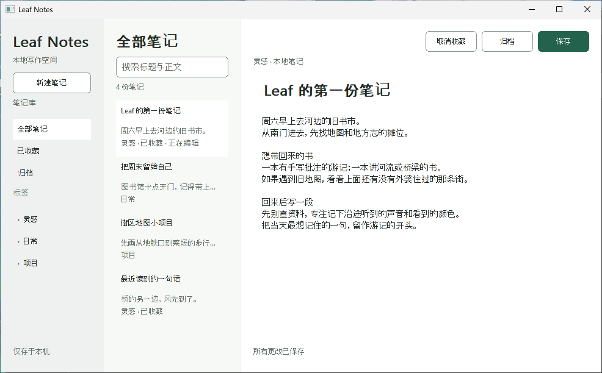

# Leaf

**用 Nim 写原生桌面应用，不用嵌入浏览器。**
界面和业务逻辑写在一起，按钮与输入框交给系统原生控件。

Windows x64 优先的 beta · [书架源码](examples/bookshelf/main.nim) · [第一个应用](docs/getting-started.md) · [文档](docs/README.md)

## 我的书架

这是一个单栏书架：搜索框下面是书名和作者。输入 `设计`，只剩《设计心理学》和《写给大家看的设计书》；清空输入框，四本书全部回来。

下面是[同一个窗口的 `view` 源码](examples/bookshelf/main.nim#L25)节选：

~~~nim
textField shelf.query, key = "search", placeholder = "搜索书名"
list shelf.matchingBooks, key = "books", rowHeight = 58,
     styles = style({"height": "full"}):
  column:
    gap: 3
    text item.title
    text item.author, variant = "secondary"
~~~

`textField shelf.query` 把输入写回状态，`shelf.matchingBooks` 用普通 Nim 代码按书名筛选。你只要描述一行里如何显示 `item`，Leaf 会用 `item.id` 识别每一行，按需创建可见行与预留行。

## 在 Windows 跑起书架

需要 **Windows x64、Nim 2.2.6+ 和 MinGW（含 windres）**。在仓库根目录打开 PowerShell：

~~~powershell
nim c -d:release --out:target/nim/leaf.exe src/leaf_cli.nim
cd examples/bookshelf
..\..\target\nim\leaf.exe build --output target\LeafBookshelf.exe
.\target\LeafBookshelf.exe
~~~

在窗口的“搜索书名”输入框试试 `设计`，再清空它。示例不需要数据库；在最后一条命令末尾加 `--dark` 可用深色主题启动。[工具链与 SDK](docs/installation.md) · [截图采集说明](docs/screenshots/README.md#书架截图)

## 更完整的应用示例

- [预约](examples/booking/README.md)：绑定姓名和日期，用可复用的步进器限制人数。
- [读书清单](examples/reading_list.nim)：把列表和编辑器拆成可复用组件；编辑草稿，点保存才更新内存中的清单。
- [Leaf Notes](examples/native_notes/README.md)：在中栏搜索，在右栏编辑，点保存才写入 SQLite。

  <picture>
    <source media="(prefers-color-scheme: dark)" srcset="docs/screenshots/leaf-notes-workbench-20261118-dark.png">
    
  </picture>
   Leaf Notes · Windows 原生应用 · <a href="docs/screenshots/leaf-notes-workbench-20261118-light.png">浅色原图</a> / <a href="docs/screenshots/leaf-notes-workbench-20261118-dark.png">深色原图</a> / <a href="docs/screenshots/README.md">截图来源</a>

## 能力与平台边界

Windows 优先的 beta：当前桌面 GUI 仅支持 Windows x64。Linux 和 macOS 会明确报不支持，没有备用 GUI；可用 headless 检查共享逻辑。Android 保留已有原生路径，未经设备矩阵验收。完整 beta 门尚未闭合，见[开发进度](docs/progress.md)。

| 想做什么 | 从这里开始 |
| --- | --- |
| 学状态、布局和事件 | [第一个应用](docs/getting-started.md) → [声明式组件](docs/declarative-components.md) → [Nim API](docs/nim-api.md) |
| 学 Windows 原生交互 | [原生表单](examples/native_forms/README.md) · [万行 SQLite 列表](examples/native_list/README.md) · [低层计数器](examples/counter.nim) |
| 生成带数据库的应用 | [脚手架](docs/scaffolding.md) → [Model](docs/models.md) → [迁移](docs/migrations.md) |
| 构建、打包与理解架构 | [源码开发](docs/development.md) · [Windows 应用打包](docs/packaging.md) · [架构](docs/architecture.md) |

## 性能：10,000 个对象的 CPU 侧开销

Leaf 按 key 更新受影响的组件，虚拟列表按需创建行，不需要浏览器运行时。

| 10,000 个对象 | CPU 侧单次操作 p95 |
| --- | ---: |
| staticFrame（静态场景重绘） | 11.67 ms |
| properties（每对象改属性） | 22.49 ms |
| geometry（每对象改几何） | 19.94 ms |

Windows VM · 软件渲染 · 10,000 对象 · 三次进程 p95 中位数（2026-10-29）。

CPU 侧耗时，不代表显示 FPS；动态场景尚未达到稳定 60 FPS 目标。完整方法与结果见 [Canvas CPU 侧性能采集](benchmarks/CANVAS_PERFORMANCE.md)。

[MIT 许可](LICENSE) · 第三方清单见打包产物内的 `licenses/inventory.json`。
