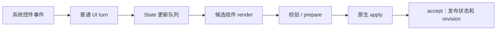

# 架构：业务状态与原生控件分开

[文档首页](README.md) · [Nim API](nim-api.md)

Leaf 的目标是：**用 Nim 描述 UI 和业务，由系统原生控件呈现**。当前优先 Windows，Android 保留已有适配；Linux/macOS GUI 尚未实现，不回退其他渲染器。

## 一次事件如何变成界面

- **render 只读**：从候选状态描述界面，不在 render 内写 State。
- **事件写入先排队**：最外层 UI 任务结束才尝试提交。
- **prepare 可以失败**：不提前接受新状态或发布业务生命周期。
- **apply 不是系统事务**：中途失败时，用已接受的描述恢复控件；恢复失败则冻结并保留清理 owner。
- **accept 不重新执行业务**：只发布已经准备好的状态、身份与元数据。

普通 Nim 副作用、文件写入和数据库提交不会随 UI 失败自动回滚；需要应用自行安排边界。

## 分层，而不是第二套运行时

| 层 | 职责 | 主要入口 |
| --- | --- | --- |
| 应用 | 组件、State、页面、任务、数据库 | `leaf`、`leaf/components`、`leaf/model` |
| managed Runtime | 身份、候选提交、生命周期、局部更新 | `managed_runtime.nim` |
| 共享 Host 协议 | 拥有的数据、句柄、属性与增量 | `host_protocol.nim`、`host_session.nim` |
| 原生适配器 | prepare/apply、能力检查、恢复 | `native_host_adapter.nim`、`backend_session.nim` |
| 平台控件 | HWND / Windows 消息，或 Android Views | `backends/win32`、`backends/android` |
| 工具链 | 默认后端、编译、打包、SDK | `targets.nim`、`build.nim`、`pack.nim` |

共享协议不传业务闭包、Node 引用或平台对象。业务回调留在 Runtime 所属 UI 线程。Windows 没有跨语言渲染桥接；Android 使用现有 C/JNI 适配。

## 原生意味着什么

Windows 使用真实系统控件，而非模拟系统皮肤。布局采用 DIP，平台按自己的 DPI 和测量结果安排像素；不要求应用再手动乘系统缩放。

样式先转为共享 typed 属性，再检查后端能力：
- 必需布局或控件行为未实现，明确拒绝。
- 装饰在 compatible 模式下可降级并报告问题；strict 模式拒绝未声明能力。
- 不用删节点、缩小数据预算或静默换渲染器来“成功”。

## 局部更新与完整快照

组件自身 State 更新可以只重算受影响实例；`memo` 使用显式 Props 比较。稳定 key 仅在相同父级和组件类型下保留身份。

普通更新使用 typed Host 增量；完整 Snapshot 和整树 validator 是显式成本。宽父容器的子句柄顺序仍可能随兄弟数增长，不承诺所有操作 O(1)，更不以结构计数冒充帧率。

虚拟列表仅物化有界可见行与暖缓存。行状态可能在淘汰或源 generation 更换时销毁；长期编辑数据应放在上层模型或 SQLite。Windows 保留单一滚动 authority，视口事实在普通安全 turn 处理，不在观察回调中强制 flush。

## 生命周期与资源

任务 worker 只接收复制数据和借用的取消信号，不访问 UI、Model 或跨线程连接。完成在普通安全点交付，经过同一提交门。CLI headless 不自动等待后台任务。

清理失败不是“已关闭”。`RuntimeCleanupError` 与 `Win32RunError` 可以保留待重试 Runtime/Host；先释放 Host，再关闭 Runtime，成功后才释放 owner。详见 [API 的清理边界](nim-api.md#组件任务与生命周期)。

## 构建与平台边界

`BackendChoice` 只保留 native，省略配置即选择原生。Windows 默认 `run(app)` 使用 Win32，无需启用额外后端标志。`-d:leafHeadlessOnly` 明确不导入 GUI；Linux/macOS 可以运行逻辑检查，但无参数窗口启动报不支持。

Windows CLI 构建嵌入 v6/PMv2 manifest。打包仅支持 Windows x64 ZIP 与现有 Android 路径。SDK 使用原生 schema 2，发布链当前只构建 Windows；不会沿用旧渲染 SDK。

历史方案、失败和已验切片保留在[进度记录](progress.md)及带日期的验收文稿中，不能当作当前全平台能力或完整验收通过。
