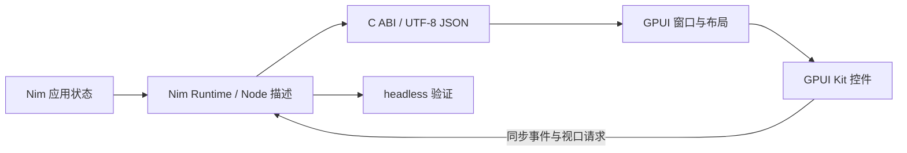

# Nim + GPUI 架构

Nim 管理应用状态、组件闭包、不可变描述、稳定身份、缓存、事件回调和虚拟列表。Rust 动态库通过 GPUI 创建窗口，使用 GPUI Kit 的控件和资源完成绘制、布局、输入与焦点管理。

`core.nim` 校验和发布完整候选树，`gpui_styles.nim` 校验桌面样式。`gpui_bridge.nim` 保留 Runtime 与返回缓冲区；`gpui_api.nim` 延迟加载 `leaf-gpui` 动态库。`desktop.rs` 协调控件，`styles.rs` 转换 GPUI 样式，`lists.rs` 使用 GPUI 原生虚拟列表按需请求 Nim 行描述。

C ABI 版本为 1。`leaf_gpui_run` 同步运行主循环，Nim owner 在整个调用期间存活。回调请求和响应均为 UTF-8 JSON；Rust 在下次请求前完成响应复制与反序列化。Nim 异常在回调内捕获；Rust 导出入口捕获 panic 并返回非零状态。双方在同一 UI 线程运行，后台线程不访问 Nim 闭包。

业务 render 在初始化与事件更新时执行。GPUI 重绘读取缓存描述；视口变更只构建所需列表行。输入实体按稳定 ID 保存，模型值不变时避免 `set_value`，保留选区、撤销与输入法组合状态。过时、禁用及无处理器的事件不执行回调。更新失败保留成功描述和回调，并展示错误信息。

CLI 通过 Cargo 增量构建桥接库，再通过 Nim 编译业务程序。桥接库放在应用可执行文件旁，发布包使用相同布局。headless 路径不初始化 GPUI、不加载桥接库。图形系统、驱动与字体属于平台运行依赖。

## A1 原生公共边界（已实现并通过 Nim 测试）

以下范围由 `scripts/test.nim` 中的 Nim 套件实际验证，不代表任何原生平台已验收：

- `styles.nim`：旧字符串 Styles 的后端中立语法校验与有类型转换（`Dimension` auto/fixed/fill、RGBA、layout/control/accessibility props；`Option` 区分未指定与显式值）。
- `core.nim` 提交门：`setCommitter` / `acceptedRevision` / `proposedRevision` / `stagingChanged` / `freezeEvents`。顺序为构建 → 校验 → preparer → committer → 发布；后端拒绝时不发布树、索引、缓存或 revision，业务对象不回滚。
- `backend.nim`：能力表、不透明 `NodeHandle`、`MountedEntity`、create/update/move/remove 批次、同步 Backend 契约与 `HostContext`；`checkCapabilities` / `effectiveProps` 区分必需能力与可降级装饰。
- `reconcile.nim`：纯差异协调器。身份按父子结构复用，祖先换类型会重建全部后代；同父变序生成可顺序应用的 handle 索引；过期或外来 plan 被拒绝（私有 owner 与 accepted-state generation）。
- `backend_session.nim` + `backends/headless.nim`：记录型 Backend 与会话。事件队列只在显式 `drainEvents` 处理；setter 通知被抑制；apply 失败恢复旧 accepted 实体并推进 mount generation，恢复失败则冻结 Runtime 业务 dispatch。列表按 handle + source generation 请求，视口按 item key 跨 source 恢复。会话关闭若发生在 Runtime 更新中会以可捕获 `UiError` 明确拒绝，host 应在安全 tick 重试；一旦开始 teardown 即进入 event-ineligible，旧队列失效，`enqueue`/`drainEvents`/`requestRows` 不再触达业务，`backend.dispose` 失败仍可重试。hook 按所有权 token 卸载，`clearCommitter`/`clearPreparer` 与安装同样经过 executionScope 和更新期 guard，不误清他人 hook。
- `-d:leafHeadlessOnly`：runner 不导入 desktop；无参数明确返回非零，不静默打开窗口。headless 构建不链接 GPUI / Vulkan。

输入法 / composition、导航历史、移动生命周期与 SQLite、Canvas、原生构建与实机验收不在 A1 范围。
