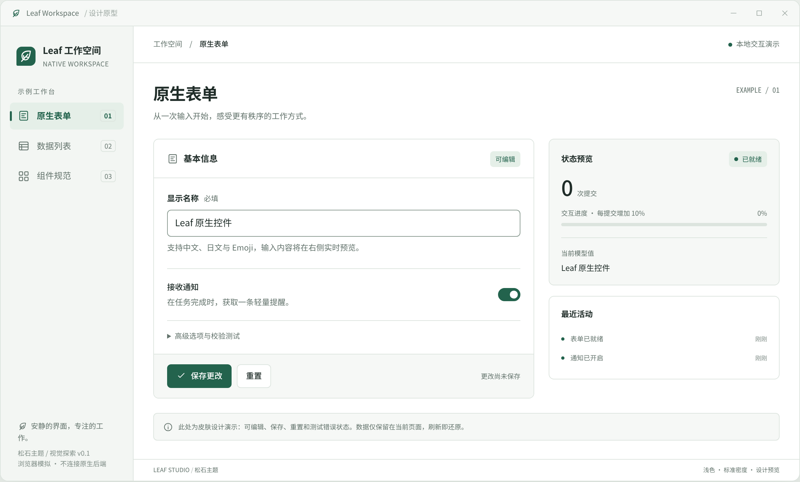

# Leaf · 松石：统一皮肤提案

状态：**表单深色细节、列表与生成模板主题已续接；列表焦点死循环已修复并通过本轮 Windows 全套及三主题真实入口开发复测。本轮独立验收未执行，按用户明确要求不再测试并提交当前切片；整套 App 风格未完成。测试后已按用户约定关闭 Windows 释放运行内存。**

## 原生开发：当前切片（非全量 V3）

- [实施计划](native-skin-plan.md) · [当前实现、实测结果与缺口](native-skin-status.md)
- 表单：[深色 v3](previews/native-win32/forms-dark-v3.png) · [错误态 v3](previews/native-win32/forms-error-dark-v3.png)；[浅色 v2](previews/native-win32/forms-light-v2.png)／[系统 v2](previews/native-win32/forms-system-v2.png)保留历史对照。
- 列表：[浅色](previews/native-win32/list-light-v3.png) · [深色](previews/native-win32/list-dark-v3.png) · [系统外观](previews/native-win32/list-system-v3.png)。真实生成 App：[浅色首页](previews/native-win32/scaffold-home-light-v3.png) · [深色首页](previews/native-win32/scaffold-home-dark-v3.png) · [深色错误](previews/native-win32/scaffold-error-dark-v3.png) · [Notes 保存后](previews/native-win32/scaffold-notes-dark-v3.png)。
- 以上来自实际 Windows EXE 的 96 DPI 原始 PNG，已查看关键页面；不是高 DPI 成品截图或独立验收，也未替换根 README 的历史截图。
- 当前实现主题、真实 EDIT 圆角／居中、字号层级、紧凑按钮、通知开关、确定进度及空值／保存状态反馈，已推广至列表示例和生成模板。原生下拉、最终整页层级及独立验收仍待完成，不能当作 V3 全量落地。

以下 V1 / V2 / V3 章节保留原型迭代过程；原生实现的最新状态以以上两个文档为准。

## 最新：V3 交互打磨

- **[打开 V3 Demo](leaf-studio-v3.html)** · [本轮改进与验证边界](refinements-v3.md)
- [浅色表单](previews/v3/forms-light.png) · [深色表单](previews/v3/forms-dark.png) · [错误反馈](previews/v3/form-error.png) · [搜索空态](previews/v3/list-empty.png)
- 保持 V2 配色；根据“按钮过大”的反馈，将操作按钮收紧到 **32px 高**，保存／重置 **96px 等宽**，减轻字重与周围留白。[深色操作区预览](previews/v3/actions-compact-dark.png)
- 优化就地反馈、真实脏状态、键盘焦点、空态恢复和开关点击区域。
- 下拉菜单采用柔和选中底色、细焦点边框和简洁选项，不再展示代码名；默认向下展开，只有底部空间不足时才上翻。[浅色组件预览](previews/v3/select-component-light.png) · [深色组件预览](previews/v3/select-component-dark.png)。菜单着色依赖浏览器支持 `appearance: base-select`；不支持时回退系统菜单。
- V1 / V2 原型保留，不覆盖用户已认可的版本。最新交互演示使用 `v3` 入口；图片仍是 HTML 原型，不是 Win32 实机截图。
- 原型自测通过；当时独立验收受旧 Pi 依赖缺失阻塞。用户已确认依赖更新，并要求本次不再测试、提交当前切片；不宣称独立验收通过。

## V2：细节优化

- **[打开 V2 Demo](leaf-studio-v2.html)** · [改进说明与网上参考来源](refinements-v2.md)
- [V2 浅色](previews/v2/forms-light.png) · [V2 深色](previews/v2/forms-dark.png) · [V2 列表](previews/v2/list-light.png)
- 保存／重置统一为 **124×40px**；统一控件档位、图标、间距与操作组，减少侧栏装饰，改善说明文字与深色层次。
- 下方保留 V1 方案和原图用于对比；V2 作为本轮迭代的视觉基线。

## 先看效果

- [V1 交互 Demo](leaf-studio.html)：下载后用浏览器打开，无需构建、联网或安装依赖。GitHub 的 HTML 文件页只展示源码，不会运行 Demo。
- [浅色表单](previews/forms-light.png) · [深色表单](previews/forms-dark.png)
- [数据列表](previews/list-light.png) · [组件规范](previews/components-light.png)

V1 / V2 / V3 预览图来自 HTML 原型，以 2× 像素密度输出，**不是 Leaf / Win32 实机截图**。`previews/native-win32/` 单独保存原生开发阶段的真实截图。根 README 图片未替换；原生阶段已修改后端和表单示例，脚手架推广尚未实施。



## 1. 理解与边界

用户希望整个 App 有一套统一、好看、可读的皮肤，并解决 README 截图模糊的问题；本轮先给方案和 Demo 看效果。

仓库实际是 Nim 声明式原生 UI 框架，当前默认桌面路径为 Win32，而不是 Web App。因此本提案针对 **Leaf 组件体系、示例及生成应用的默认外观**，不引入 WebView、不恢复已退役渲染器。

设计面向桌面生产力工具，重视中文长文本、键盘操作、数据录入及列表密度。松石方向已获得确认；侧栏工作台仍是展示容器，不意味着所有正式应用都必须复制整页结构。

侧栏用于集中比较表单、列表和组件规范，不要求所有生成应用都必须有侧栏；单页应用只使用内容区和同套组件。

### 原型阶段检查清单（历史）

- [x] 检查 README、原始截图、现有表单、列表说明和 Win32 能力表。
- [x] 明确本轮仅设计与原型，不落地正式皮肤。
- [x] 比较视觉方向，给出推荐方案。
- [x] 提供三页交互 Demo 与浅／深色预览。
- [x] 浏览器自测交互、键盘焦点及不同宽度，并查看实际渲染截图。
- [x] 用户反馈并确认开始原生开发。
- [ ] 原生第一阶段整体完成并通过独立验收；当前进展见[原生状态](native-skin-status.md)。

## 2. 三个方向

| 方向 | 特征 | 取舍 |
| --- | --- | --- |
| **松石 / 推荐** | 暖白、松绿、小圆角、细边框；清晰但不冷淡 | 有 Leaf 品牌辨识度；完整落地需要扩展 Win32 绘制能力 |
| 系统精修 | 保持系统灰与系统按钮，优先改布局、留白和字号 | 改造风险低，但无法达到本 Demo 的统一皮肤效果 |
| 深色技术风 | 石墨底、蓝色强调、更紧凑的工具面板 | 适合开发工具，但不宜作为全部应用的唯一默认风格 |

选择松石作为完整展示稿，配套深色版本；不同时设计三套完整皮肤，先确认主方向。

## 3. 统一视觉规则

### 语义 Token

| 角色 | 浅色 | 深色 |
| --- | --- | --- |
| 页面底色 | `#EDF0ED` | `#141C19` |
| 内容表面 | `#FFFFFF` | `#202B26` |
| 次级表面 | `#F6F8F6` | `#26322C` |
| 侧栏 | `#F3F6F3` | `#1C2721` |
| 主文字 | `#202D29` | `#EDF3EF` |
| 次级文字 | `#64746D` | `#A9BBB0` |
| 强调色 | `#23634D` | `#9DD8B8` |
| 强调底色 | `#E5EFE8` | `#2B4336` |
| 边线 | `#DCE4DE` | `#42544A` |
| 错误 | `#AD3939` | `#FFAAA4` |

不要将浅色主题的颜色整体反转；深色需要单独定义表面层次、边线与文字颜色。系统高对比模式应优先使用系统色，不强制品牌色。

### 字体、间距、控件

- Windows 优先 Segoe UI Variable / Segoe UI，中文回退 Microsoft YaHei UI；演示在 Linux 使用本地 Noto CJK，不下载远程字体。
- 标准正文 14 DIP，说明文字 12 DIP，页面标题 24–28 DIP；辅助编号可更小，不承担关键操作信息。
- 以 4 DIP 为基本步进、8 DIP 为主要节奏，常用间距 8 / 12 / 16 / 24 / 32 DIP。
- 主按钮与输入框高 36–40 DIP，列表紧凑操作可更小，但正式实现需验证可点击面积与长文裁剪。
- 控件圆角 6 DIP，分区 8 DIP；内部主要依靠边框与底色，不层层叠加阴影。
- 当前 HTML 中 `px` 是视觉代理，正式原生实现需要映射到 DIP，并由当前窗口 DPI 转换为物理像素。
- 图标采用单色线性风格，不用 Emoji 替代导航和操作图标。

### 页面与状态

- 表单：页面标题 → 基本信息 → 主次操作；状态反馈独立成组，技术探针收进高级区域。
- 数据列表：工具栏 → 固定列语义 → 逐行备注／完成／保存 → 可读的空状态。Demo 的搜索与筛选是探索，不表示正式示例已经具备。
- 主按钮每个区域一个，重置为次按钮，危险操作使用文字与颜色双重提示。
- 覆盖默认、悬停、键盘焦点、禁用、错误、成功、空状态；后续正式实施还须补齐加载与原生忙碌态，避免重复提交。
- 错误靠近关联输入，保留草稿，说明如何恢复；成功反馈不只改变颜色。
- 深色与浅色复用组件结构、间距和行为；切换只替换语义 Token。

## 4. Demo 包含什么

`leaf-studio.html` 是单文件，无外部资源请求：

1. 表单：实时模型预览、通知开关、保存计数、重置、空值校验、输入模式、失败候选与恢复。
2. 列表：6 条内存样例、关键词搜索、完成筛选、逐行编辑与保存、空结果提示。
3. 组件规范：色彩、按钮层级、输入和多种反馈状态。
4. 深浅色切换与窄屏浏览，便于查看方案；窄屏适配**不表示 Android 已验收**。

不模拟真实 IME、系统窗口行为、SQLite 持久化、异步任务或万行虚拟化性能。进度每次提交增加 10%，仅为展示进度条，与现有示例的计数算法不同。刷新后所有修改还原。

## 5. 原生落地可行性与分期

检查入口：`src/leaf/styles.nim`、`src/leaf/backends/win32/capabilities.nim`、`src/leaf/native_layout.nim`。

当前语法可以描述颜色、字体、圆角等，但 Win32 仍声明 `decorations: {}`。系统外观仅支持 `variantDefault`；显式选择松石主题后，按钮支持 `primary` / `secondary`，文本支持 `primary` / `secondary` / `danger`，输入支持 `danger`。校验与有效属性投影均按控件类型判断。**不能只在 Nim 页面里填写颜色，就宣称统一皮肤已经落地。**

原生开发已获准，按以下三个阶段推进；目前第一阶段仅完成主题基础切片，尚未整体完成：

1. **原生能力验证切片**：定义主题 Token 的应用范围与系统默认回退；完成一个真实表单的字体、内容底色、文本、输入框、按钮、焦点及错误态。保留真实 EDIT 的输入／选择／IME 语义，不能用自绘文本输入冒充支持。需要明确哪些控件沿用系统绘制、哪些需要定制；圆角及深色不可作为现成承诺。
2. **组件与模板统一**：将验证后的规则推广至通知／勾选、进度、导航、虚拟列表及生成模板；共享样式规则，不复制多份主题。保留无主题兼容路径；高对比模式、主题变更、字体／画刷生命周期必须有明确处理。
3. **真实入口验收与截图**：Windows 实机验证表单、列表和生成应用，覆盖 100% / 150% / 200% DPI、键盘焦点、长中文、真实 IME、系统主题／高对比及必要回归。实施负责人自测后进行独立验收，最后再更新 README。

Android 保留原生路径，后续按平台单独映射语义 Token；本轮不扩大为跨平台实现任务。CLI 不纳入 GUI 皮肤。

## 6. README 截图优化方案

### 已核实的现状

- `docs/screenshots/native-forms-win32.png` 实际是 **656×679** 的 PNG。
- `README.md` 写死 `width="480"`，只有约 1.37× 像素储备，不能满足 2× 显示。
- 图中控件与文字很小，窗口下半部大量空白，且带入了旁边窗口／桌面边缘。
- 缩到 480px 后关键文字更小；用户展示图若还经历额外缩放，会进一步损失清晰度。不能仅凭 PNG 格式认定所有模糊都由有损压缩导致。

### 正式采集规范

1. 从**真实新版 Windows 应用**采集，不用 HTML 原型替代实机截图。
2. 系统实际 200% DPI，窗口逻辑尺寸约 1120×720 DIP，目标物理图约 2240×1440；如果使用其他 DPI，原样记录。不能将 96 DPI 旧图插值放大冒充高 DPI。
3. 截取目标窗口，不带桌面或其他应用；只做裁切及无损优化，不修绘控件。
4. 展示有代表性的内容与状态，让主体占据合理面积，不用大片空白撑大窗口。
5. 主图保留无损 PNG；README 期望展示宽度约 960px，并允许 GitHub 内容区域自然约束。主图链接原始大图；必要时补一张关键交互近景，而不是拼成无法阅读的长图。
6. 图注注明来源示例、实际 Windows／DPI、主题、对应提交；新功能未落地前不改掉现有“真实原生截图”的说明。
7. 验收时同时查看原图与 GitHub 实际渲染尺寸，确认中文、按钮和列表内容无需放大也可辨认。

未来 README 嵌入示意（**不是本轮已存在的实机文件**）：

```html
<p align="center">
  <a href="docs/screenshots/leaf-studio-win32-2x.png">
    
  </a>
</p>
```

本轮 Demo 已提供 2× PNG 预览，供看清视觉方案；不据此宣称 README 真实截图问题已经修复。

## 7. 本轮验证与剩余事项

使用本机 Chromium + Playwright 检查 HTML 原型，**36 项自测通过**：包含中文／Emoji 输入、保存／空值阻止、候选失败与恢复、两种输入模式、主题切换、列表筛选与逐行保存、空状态、Tab 焦点，以及 1440 / 1024 / 768 / 390px 三页无页面级横向溢出。窄屏列表允许表格内部横向滚动。

原型阶段已查看浅色、深色、列表及窄屏渲染图；当时仅新增设计材料，没有运行产品测试。后续原生开发已有真实 Windows 编译、截图及产品回归，结果单列于[原生状态](native-skin-status.md)，不混用两阶段证据。

自测脚本、运行结果和窄屏截图留存于本机 `~/.local/state/agent-artifacts/leaf/2026-10-25-skin-demo/`。运行日志若发现问题，修复后重新执行；不以初次失败结果冒充通过。

原型反馈入口为 **[V3 细节预览](leaf-studio-v3.html)**；V1 / V2 的记录仅对应各自版本。用户随后确认开始开发，原生实现见[实施计划](native-skin-plan.md)，不把局部切片或原型自测当作全 App 完成。
