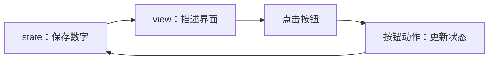

# 第一个 Leaf 应用

[文档首页](README.md) → **第一个应用** → [生成完整应用](scaffolding.md)

**环境：Windows x64，使用本轮原生源码 CLI 或新原生 SDK。** Linux/macOS GUI 暂不支持；旧 SDK 不能代替当前实现。

**目标：点击按钮，让界面上的数字加一。** 先看数据流，再看完整代码。



## 1. 创建项目

先[安装 SDK](installation.md)，再在终端执行：

```sh
leaf init my-app
cd my-app
leaf run
```

你会看到模板窗口。关闭它，然后把 `src/main.nim` 替换为下面的**完整代码**。

## 2. 写一个计数器

```nim
import leaf

component Counter:
  state:
    count = 0
  view:
    column:
      padding: 32
      gap: 16
      text "我的第一个 Leaf 应用"
      text count:
        key: "count"
      button "增加 +1", key = "add":
        count += 1

when isMainModule:
  quit(run(app(Counter, title = "第一个 Leaf 应用", width = 460, height = 320)))
```

`state` 在组件挂载时初始化；`view` 读取状态；按钮动作更新状态。稳定的 `key` 也让测试能按名称点击或读取控件。`app` 构造应用描述，`run` 负责桌面或 headless 启动。

> 不要在 `view` 渲染期间写状态。事件写入由 Runtime 校验和提交；普通 Nim 副作用不会随着 UI 拒绝而回滚。

## 3. 不打开窗口，也能检查交互

在同一项目目录执行：

```sh
leaf --check
leaf --headless --click add --click add
```

第二条命令运行真实 Nim 回调，输出的树中 `count` 文本应为 `2`。这验证逻辑，不验证画面、焦点或输入法。带数据库的应用初始化可能产生写入，检查时请指定测试数据库。

## 下一步

| 想继续学 | 去哪里 |
| --- | --- |
| 搜索、选择、编辑与保存 | [读书清单源码](../examples/reading_list.nim) · [字段绑定、列表和事件](declarative-components.md#虚拟列表与命名事件) |
| 声明可复用控件、绑定输入 | [声明式组件](declarative-components.md) · [预约示例](../examples/booking/README.md) |
| 增加布局、输入框和列表 | [Nim API](nim-api.md) · [待办源码](../examples/todo.nim) |
| 看完整应用可以长什么样 | [Windows 原生表单](../examples/native_forms/README.md) |
| 不想从零搭页面和数据库 | [生成 CRUD 应用](scaffolding.md) |
| 想知道状态为什么这样设计 | [架构与提交边界](architecture.md) |
