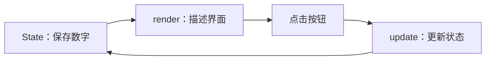

# 第一个 Leaf 应用

[文档首页](README.md) → **第一个应用** → [生成完整应用](scaffolding.md)

**环境：Windows x64，使用本轮原生源码 CLI 或新原生 SDK。** Linux/macOS GUI 暂不支持；旧 SDK 不能代替当前实现。

**目标：点击按钮，让界面上的数字加一。** 先看数据流，再看完整代码。



## 1. 创建项目

先[安装 SDK](installation.md)，再在终端执行：

```sh
leaf init my-app
cd my-app
leaf run
```

你会看到模板窗口。关闭它，然后把 `src/main.nim` 替换为下面的**完整代码**。

## 2. 写一个计数器

```nim
import leaf

let Counter = defineComponent[int, State[int]]("Counter",
  proc(ctx: MountContext, initial: int): State[int] =
    ctx.state(initial),
  proc(ctx: ComponentContext, initial: int, count: State[int]): UiDescription =
    let n = ctx.value(count)
    componentView:
      column:
        styles: {"padding": "32", "gap": "16"}
        text "我的第一个 Leaf 应用":
          styles: {"font_size": "24", "weight": "bold"}
        text $n:
          key: "count"
          styles: {"font_size": "48"}
        button "增加 +1":
          key: "add"
          onClick(e):
            discard count.update(proc(v: int): int = v + 1))

proc counterApp(): Application =
  componentApplication(component(Counter, 0), "第一个 Leaf 应用", 460, 320)

when isMainModule:
  quit(run(counterApp()))
```

执行 `leaf run`，点击“增加 +1”。只需要记住三个操作：

| 操作 | 意义 | 发生的位置 |
| --- | --- | --- |
| `ctx.state(initial)` | 创建由组件持有的状态 | 挂载时，执行一次 |
| `ctx.value(count)` | 读取本次渲染的状态 | render 中 |
| `count.update(...)` | 从当前值计算下一个值 | 用户事件中 |

`defineComponent` 的两个函数分别负责**初始化**和**渲染**；`componentApplication` 把根组件变成窗口应用。泛型参数是初始参数和组件模型的类型，不是每个控件都要写的模板。

> 不要在 render 中写 State，也不要用普通全局变量代替需要事务化提交的组件状态。事件写入先排队，再由 Runtime 校验并提交；普通 Nim 副作用不随 UI 拒绝自动回滚。

## 3. 不打开窗口，也能检查交互

在同一项目目录执行：

```sh
leaf --check
leaf --headless --click add --click add
```

第二条命令运行真实 Nim 回调，输出的树中 `count` 文本应为 `2`。这验证逻辑，不验证画面、焦点或输入法。带数据库的应用初始化可能产生写入，检查时请指定测试数据库。

## 下一步

| 想继续学 | 去哪里 |
| --- | --- |
| 增加布局、输入框和列表 | [Nim API](nim-api.md) · [待办源码](../examples/todo.nim) |
| 看完整应用可以长什么样 | [Windows 原生表单](../examples/native_forms/README.md) |
| 不想从零搭页面和数据库 | [生成 CRUD 应用](scaffolding.md) |
| 想知道状态为什么这样设计 | [架构与提交边界](architecture.md) |
