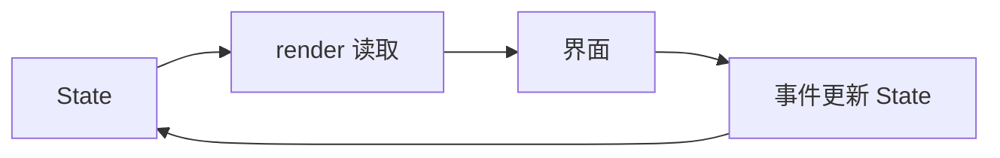

# Nim API：按你要做的事查

[文档首页](README.md) · [完整入门代码](getting-started.md) · [示例目录](../examples/README.md)

**统一入口：`import leaf`。** 应用使用托管组件，Windows 默认由 Win32 系统原生控件呈现；不再使用 `Application(render: ...)`。

| 想做什么 | 本页入口 | 完整示例 |
| --- | --- | --- |
| 保存并更新界面状态 | [组件与 State](#组件与-state) | [计数器](../examples/counter.nim) |
| 排列控件、处理输入 | [布局与事件](#布局与事件) | [原生表单](../examples/native_forms/README.md) |
| 只构建看得见的列表行 | [列表](#列表) | [原生列表](../examples/native_list/README.md) |
| 切页面、保留状态、返回 | [组件页面路由](#组件页面路由) | [页面应用](../examples/component_pages.nim) |
| 后台加载、取消、重试 | [组件任务与生命周期](#组件任务与生命周期) | [任务应用](../examples/component_tasks.nim) |
| 保存数据与读取资源 | [SQLite 存储](#sqlite-存储) · [资源](#宿主资源与私有数据路径) | [Model](models.md) |
| 使用移动入口 | [Android](#android-入口) | [脚手架](scaffolding.md#android-入口) |

## 组件与 State



| API | 什么时候用 |
| --- | --- |
| `defineComponent[Props, Model]` | 定义挂载初始化和 render |
| `ctx.state(initial)` | 在初始化时创建组件状态 |
| `ctx.value(state)` | render 中读取当前候选值 |
| `state.set(value)` / `state.update(updater)` | 在事件中排队更新 |
| `componentApplication(component(...), title, width, height)` | 创建窗口应用 |

**render 只读，事件写入。** 引用或可变容器必须提供独立 snapshot，避免修改到已接受值。普通 Nim 副作用不随 UI 提交失败自动回滚。

<details>
<summary>进阶：提交、身份、memo、缓存与诊断</summary>

`leaf` 默认导出唯一组件 API：通过 `defineComponent[Props,Model]` 定义 `MountContext` 初始化和 `ComponentContext` render，再用 `componentApplication(component(...),title)` 创建应用。完整可运行示例见 `examples/component_counter.nim`。旧的 `Application(render:...)`/`BuildContext` 运行路径已移除。

`ctx.state(initial)` 在挂载时建立 State；render 用 `ctx.value(state)` 读取当前候选。`state.set(value)` / `state.update(proc(old):T=...)` 排队，事件结束、`runtime.uiTask` 或 `runtime.batch` 最外层结束统一提交；手动 `runtime.flush()` 也可结算。队列在尝试开始时封存，失败不会自动重放 updater。初始化、render、updater 和提交期间禁止写 State；在一个 Runtime 的 UI 任务中也不能写另一个 Runtime 的 State 或嵌套进入它。普通 Nim 变量的修改仍是普通副作用，不随提交拒绝回滚。引用或可变容器类型必须提供独立 snapshot 函数，避免候选修改接受值。

组件默认在父 render 传入新描述时计算；`memo(def,equals)` 使用明确的 Props 比较，也可使用版本 token。memo 不阻止自身 State 更新或脏后代更新。稳定 key 只在相同父级、相同组件类型下保留身份；换父、换类型、换 key 会重挂载。无 key 使用位置身份。事件回调即使宿主属性未变也会更新到新接受版本。

`componentView` 与原 `view` 共用控制流语法，可以混合宿主节点与组件。`componentList` 提供组件行，可用 `styles` 设置列表尺寸；变量行高由原生宿主测量，在普通安全 turn 合并视口请求。滚出视口后 State 暂存于有限暖缓存，淘汰或源 generation 更换后旧 State 写入返回 disposed。需要长期保存的行数据应放在上层模型。

`runtime.snapshot` 和整树 validator 是显式完整导出；高频局部查询使用 `runtime.find(key)`，观察局部工作量使用 `runtime.updateStats()`。窗口更新通过共享 Host 协议和原生适配器提交，不加载渲染桥接库。

托管节点的完整诊断 ID 是内部格式，包含组件类型身份；业务查找应使用稳定 `key`。普通组件类型替换或卸载再挂载会建立新原生输入控件。列表源 generation 更换会销毁旧行 State；不要依赖跨源保留输入草稿。

</details>

## 布局与事件

下面是**组件 render 内的节选**；`name` 是已初始化的 `State[string]`，`value` 来自 `ctx.value(name)`：

```nim
componentView:
  column:
    styles: {"padding": "24", "gap": "12"}
    text "个人资料"
    input value:
      key: "name"
      placeholder: "输入姓名"
      onChange(e): discard name.set(e.value)
```

| 控件 | 用途 / 常用事件 |
| --- | --- |
| `column` / `row` | 纵向 / 横向布局 |
| `text` / `tag` | 文本 / 状态标签 |
| `button` | `onClick(e)` |
| `input` | `onChange(e)`、`onSubmit(e)`；文本在 `e.value` |
| `checkbox` / `switch` | `onChange(e)`；布尔值在 `e.checked` |
| `progress` / `separator` / `spinner` | 进度 / 分隔 / 加载 |

给交互控件设置**稳定 key**；同一父级内唯一。受控输入必须在 `onChange` 中更新状态，否则模型可能把显示值恢复。

<details>
<summary>DSL、样式与容器组合规则</summary>

- `componentView:` 可混合宿主控件和组件；`view:` 返回纯 Node，用 `host` 接入托管描述；`views:` 返回多个 Node。
- 一个描述恰好有一个根；属性放在组件块直接层级。已有回调可写 `onClick: callback`。
- `styles:` 接受表字面量或 Styles；支持尺寸、padding、gap、flex、对齐、颜色、字体、边框、圆角与 overflow。各后端能力不同。
- 布局内支持普通 Nim 的 let、if、case、for、while、block 等；自定义容器可接收 `children: seq[Node]`。
- 动态子节点可用 `children: nodes`，不能同时再嵌套子组件。DSL 在编译期展开，仍受 Nim 类型检查。

</details>

## 列表

| 场景 | 选择 |
| --- | --- |
| 纯 Node 行，按需生成 | `virtualList` |
| 每行拥有独立组件与 State | `componentList` |
| 必须长期保存编辑数据 | 上层模型或数据库，不只放在行 State |

固定行高使用 `rowHeight > 0`；变高列表以估计高度起步，再由宿主测量。列表最多十万项；离屏行只有**有限暖缓存**，淘汰或 source generation 更换会销毁旧 State。编辑状态保留和 source 替换的细则见上方进阶说明。

## 组件页面路由

`newComponentRouter` 在初始化中创建，`renderPage(ctx, router)` 在 render 中输出页面。

| 操作 | 意义 |
| --- | --- |
| `navigate` | 选择地址，不增加历史深度 |
| `push` / `replace` / `pop` | 历史前进 / 替换 / 返回 |
| `retainState`（默认） | 离开后保留 State，返回时重建宿主 |
| `disposeOnLeave` | 离开被接受后销毁，返回时重新初始化 |

保留 State **不保证**保留光标、焦点、滚动或 IME 组合。`renderNavigation` 是可选的原生导航容器。

<details>
<summary>进阶：路由事务、系统返回、平台限制与预算</summary>

`leaf/components` 额外导出 `Route`、`PageRetention`、`ComponentPageDefinition`、`ComponentRouter`、`newComponentRouter`、`routes`、`navigate`、`currentRoute` 与 `renderPage`。路由在持有它的组件 initialize 中用 `newComponentRouter(ctx, routes, pages, initial)` 创建；`renderPage(ctx, router)` 在当前组件 render 中返回唯一页面出口，构造时只捕获当前页面的 build 与 view，不执行页面 build。`navigate(router, nameOrPath)` 把地址写入普通 State 队列，与同批 State、宿主和 revision 一起接受；未知地址抛出 `UiError` 且不排队，router 已销毁时返回 `StateWriteResult.disposed`。地址与页面配置在创建时复制并校验，之后不可变；`routes(router)` 返回副本。

`push(router, target)` 追加历史条目（同地址也有新条目身份），`replace(router, target)` 替换栈顶，`pop(router)` 返回上一条；根处 pop 保持原值。兼容 `navigate` 替换当前地址且不增加深度，同地址不触发页面 render。几次操作进入同一批时按顺序折叠；候选失败保留原历史，并消费失败批次，不自动重试。`history(router)` 返回已接受的 root→current 地址副本，`history(ctx, router)` 在所属组件 render 中读取候选，`canPop(router)` 查询是否能返回。历史最多 10000 条；重复地址仍复用现有按 page 保留的组件模型，不因此创建独立业务对象。

宿主可用 `backProposal(router, requestId)` 登记返回提案，requestId 在该 router 内严格递增；返回的 `NavigationBackProposal.requestId == 0` 表示根或已过期请求。`cancelBack(router, requestId)` 在确认前撤销请求，不写历史；`confirmBack(router, proposal)` 仅在原登记提案仍有效时返回 true 并排队一次 pop，true 表示已排队，最终仍受正常提交门约束。重复、取消、伪造和历史版本已变的完成返回 false。已排队的请求即使候选失败也不能重用，重试需新 requestId；取消边界截止于确认排队。平台还需核对自身 session/mount，不能用此共享 API 的测试代替各平台原生导航验收；Android ABI5 的容器与系统返回接线见下文，转场动画未实现。

页面生命周期由框架维护：默认 `PageRetention.retainState`，离开时移除该页宿主与活动事件、保留组件身份和 State，返回时分配新宿主句柄；`PageRetention.disposeOnLeave` 在离开被接受后递归卸载页面组件，旧 State 句柄变为 disposed，返回时重新初始化。隐藏页仍可接受 State 写入，但不 render、不导出；恢复时读取最新已接受值。整组保留页与列表暖行在 router 组件卸载时释放。保留不承诺光标、选区、焦点、滚动位置或未完成 IME 组合；重新挂载的输入控件建立新 Entity。

`renderNavigation(ctx, router, key)` 是显式选择 typed 原生宿主的出口，保留 `renderPage` 的页面 State/retention 语义，并额外生成一个 `NodeKind.navigation` 容器；旧 `renderPage` 仍为透明出口。导航元数据仅包含 router/history revision/current/previous/depth，不传路由字符串、业务闭包或第二份历史栈。当前共享宿主与记录后端已接线。Android ABI5/LAV5 提供单一无歧义导航容器和系统返回事实桥；ABI1–4 保留旧能力并拒绝导航；Win32 已支持 typed 导航容器。Android 宿主须在 manifest 启用 `android:enableOnBackInvokedCallback="true"`。API34+ 接 begin/cancel/confirm，API33 接 invoked，API26–32 接 legacy back；仅普通前台 turn 提交历史。当前不提供转场动画；API26–33 路径尚无设备运行证据。

Win32 将 Alt+Left 与 `WM_APPCOMMAND/APPCOMMAND_BROWSER_BACKWARD` 登记为普通 UI turn 的返回事实，按键自动重复会折叠；输入正在 composition 时让编辑器处理。history-only 更新保留容器 HWND，返回候选失败时恢复原 accepted 历史，不在 idle 自动重试。当前原生测试覆盖注入 Win32 消息、重挂载和故障回放；物理键盘、自然 IME、多栈、动画和跨 DPI 尚未验收。

原生适配器通过 `BackendSession.queueNavigation` 登记带 session/mount/handle/binding/revision/sequence/requestId 的 begin/cancel/confirm 事实。begin/cancel 不执行业务，confirm 进入同一普通事件队列，交付前重新核对 accepted 身份；取消可在原生事实被 claim 前撤销。此取消边界位于 router 的 `confirmBack` 入队之前。平台 requestId 在同一 session 内跨容器单调，并须满足 retained router 的单调要求；挂载重建不能复用该 router 已消费的请求。已登记事实不代表 pop 成功，最终以 accepted 导航元数据为准。该队列会分配，未作零分配声明。

`PageOutletSpec`、`pageOutlet`、`outletSpec` 以及 owner/accounting helper 都是运行时内部入口，不从 `leaf/components` 导出。`DescriptionKind` 是可见枚举，新增 `pageOutlet` 值：对描述类型写穷尽 `case` 的低层代码需要显式处理该值，普通 `host`/`component` 使用方式不变。`ComponentRouter` 的配置字节与所属组件一起计入现有 `MaxTreeBytes` 预算，未显示的 controller 也不例外。完整可运行示例见 `examples/component_pages.nim`。

</details>

## 组件任务与生命周期

后台 `work` 处理复制的数据，UI 完成回调再写 State。看[完整任务示例](../examples/component_tasks.nim)，不要从 worker 访问 UI、Model 或页面连接。

| 默认行为 | 注意 |
| --- | --- |
| 离开页面取消任务 | 取消是协作式，不撤销已提交外部写入 |
| 保留页可显式选择隐藏继续 | 页面销毁或 Runtime 关闭仍取消 |
| Win32 普通安全点交付完成 | 普通 CLI headless 不等待后台任务 |
| 每个 worker 自建数据库连接 | 不跨线程传连接，不让作用域跨 await |

<details>
<summary>进阶：任务额度、泵预算、关闭与清理 owner</summary>

`import leaf/components` 导出 `ctx.onMount/onActivate/onDeactivate/onDispose`、`ctx.taskScope(retention=cancelOnDeactivate)`、`startTask` 和 `cancel`。初始化只登记回调；只有接受的转换才触发生命周期。首次可见也可能是 `onActivate`（例如最初为暖行的组件），不要假定 `onMount` 总先到，或在两处无条件重复启动任务。示例 [component_tasks.nim](../examples/component_tasks.nim) 导出 `tasksApplication(title="Leaf component tasks")`，演示加载、错误重试、默认离开取消、隐藏继续和离开销毁。

`work(input:string,ctx:WorkerContext):string {.nimcall,gcsafe.}` 只能接收复制的字节和借用的取消信号，不能捕获 UI 闭包、State、Runtime、Model/Query 或连接；不使用 `cast(gcsafe)` 绕过检查。`ctx.cancelled` 是协作式取消，work 不得保存 ctx。结果/错误处理器留在 UI scope，更新 State 后走正常宿主接受门禁。相同 owner/key 的新请求替代旧请求，旧完成不可写回重建或换绑后的 owner。取消不会撤销已经发生的外部写入，重试应考虑幂等性。

默认离开页面/活动列表行取消；`keepWhileRetained` 允许隐藏继续，隐藏 State 更新不 render，返回时呈现完成结果。`disposeOnLeave`、暖行淘汰和 Runtime 关闭仍取消保留任务。取消或替换的旧 work 在真正退出并 ack 前仍占任务/结果额度。默认两条 worker、64 个未收尾任务；单 input 1MiB、key 256 UTF-8 字节、总 input 8MiB；默认结果 65536 字节，上限 1MiB，总结果预留 8MiB。错误消息有界为 4KiB 且保持 UTF-8。

`pumpTasks(runtime)` 每轮最多认领 64 条完成/回调，4ms 是开始下一条的调度预算，不抢占当前 handler。`TaskPumpReport.delivered` 包括有效 work 错误的完成 claim；`callbacks` 是实际 handler 数；`failed` 是交付/作用域异常数，不是 work 错误数。未提供 onError 仍消费完成并记录有界错误。完成回调失败或其 UI 更新拒绝不会重放同一消息。`taskPumpPending` 只查 metadata，不消费、render、导出 Snapshot 或变更 revision。

Win32 在 ordinary UI 安全点自动泵；headless 工具/SDK fixture 自行在有界循环显式 `pumpTasks`，CLI 普通 `--headless` 不等待后台任务。空 tick 不 render、不导出 Snapshot、不发送 UI 树、不增加 revision。共享 typed Host 增量是原生窗口更新通道；完整树只用于显式诊断/初次同步。

普通退出必须 `closeRuntime`。业务回调内关闭先使 State 无效/关投递门，未 claim 的 dispose 与 pool 回收留到 ordinary 边界。scope 拒绝后可显式再次关闭，不能把 closed 当全部清理完成。

Win32 `runNative` 同样支持 `cleanupOwner` 和 `Win32RunError(cleanupRuntime,cleanupHost,exitStatus)`。若 Host 资源仍未释放，即使提供 Runtime out 也必须处理双 owner 异常：先 ordinary `cleanupHost.destroyHost()` 成功，再 `cleanupRuntime.closeRuntime()`；失败继续持有 owner。WndProc/renderer/native callback 不负责最终 join，也没有析构自动重试。

`RuntimeCleanupError` 在 `leaf/core` 定义，公开 `cleanupRuntime: Runtime`、`exitStatus: Option[int]`；`Win32RunError` 继承它，Win32 另有 `cleanupHost`。`newRuntime` 首次已接受刷新在 scope-exit 报错时，完全退出保护域后只尝试一次 ordinary close；清理成功原样抛出原错误，清理拒绝则由共用异常保存原 msg/parent 和可重试 owner，status 为 none。未接受候选不执行 dispose，也不会为清理而泵 mount/activate/work。

`run(app, args, cleanupOwner=nil)`、`run(app, cleanupOwner=nil)` 和 `runHeadless` 的两个重载也支持末尾 owner 输出；slot 必须预先为 nil。高层 `run` 继续传播带待清理 Runtime/Host 的异常，普通无 owner 错误保留诊断/整数合同。构造已经尝试过清理时，外层只移交 owner，不立即再 close；诊断对象收尾不能覆盖 pending owner。headless 在正常、check、help 和错误出口关闭 Runtime，然后关闭诊断对象；它不自动泵任务、不等待后台结果。

有 out 时，即使整数返回 0，也必须检查 owner 是否非 nil：整数保留运行状态，不表示清理完成。恢复 scope 条件后在 ordinary UI 边界显式 `owner.closeRuntime()`；成功后将 out 和保存的异常引用清空。无 out 时仅最终清理失败以异常的 some(status) 保存整数；原业务/构造异常与清理同时失败时保留原 msg/parent、none status，不能吞成整数。Win32 的 pending Host 仍必须先 destroyHost，再 closeRuntime，不能只处理共用 Runtime 字段。

</details>

## SQLite 存储

查询对象、校验和事务见 [Model](models.md)；表结构变更见[迁移](migrations.md)。只需 SQL 时导入 `leaf/sqlite`，使用参数绑定而不是拼接用户输入。

<details>
<summary>低层 SQL API、绑定值与 SQLite 平台实现</summary>

`import leaf/sqlite` 提供 `openDatabase(path)`、`close()`、`execute(sql, values)`、`query(sql, values)`、`lastInsertId` 和 `migrate(migrations)`。`dbValue` 绑定字符串、整数、浮点数与布尔值，查询值通过 `asString`、`asInt`、`asFloat`、`asBool` 读取；`SqlValue(kind: sqlNull)` 表示 NULL。`execute` 返回受影响行数。`execute`/`query` 只接受单条 SQL，并检查参数数量；可信迁移脚本使用 `executeScript`。

`Migration(version, name, sql)` 定义一个版本，`migrate` 接收完整迁移历史并按版本应用尚未执行的 SQL，每个版本事务提交。连接在所属线程使用；显式关闭后的操作会抛出 `DatabaseError`。完整应用模板在启动时配置连接与迁移，并将连接传给组件页面与服务。

Android 将固定的 SQLite 3.54.1 编入应用，Leaf、Norm 与 lowdb 共用同一实现；桌面默认仍使用动态库。`-d:leafBundledSqlite` 可在本地验证应用内引擎。借用连接不能交给另一个 SQLite 库释放或操作；Windows 默认三种绑定已在真实 Windows 用例中验证共用 `winsqlite3.dll`；统一 `-d:leafOrmSqliteLibrary` 可覆盖三者，Windows override 仅经编译验证，未作运行通过声明。

</details>

## 宿主资源与私有数据路径

`readAsset` 读取资源；`dataPath` 获取私有数据路径；`asset` 为只收文件路径的 API 提取缓存。读取资源会执行 I/O，放在普通业务边界，不要当作零成本 render 操作。

<details>
<summary>路径安全、预算、缓存与 HostResources 生命周期</summary>

`import leaf/app_resources` 提供显式的 `HostResources`。`readAsset(relative, maxBytes)` 返回拥有的二进制 string，允许内容含 NUL；默认单资源预算 1 MiB，可调低。相对路径须符合项目的可移植路径规则，最长 4096 字节。`dataPath(relative)` 返回私有数据根内的路径，不创建目录或打开数据库；业务按需创建父目录。已有路径前缀会检查 canonical 路径，拒绝符号链接逃出根目录。

`asset(resources, relative)` 为只接受文件路径的 API 按需提取资源，保留相对文件名和后缀，存入私有 cache 根下的内容 SHA256 目录。已有内容一致时复用，内容不符时拒绝；没有跨进程 writer 协调或自动缓存回收。读取和提取会分配并执行 I/O，应在普通业务边界调用。

Android 可从 `leaf/backends/android/ffi` 注册 `proc(resources: HostResources): Application` 工厂。`LeafActivity` 以 applicationContext 的 assets/filesDir/cacheDir 建立资源宿主，Activity 重建沿用原 Runtime 的资源；终态清理成功后旧资源访问拒绝。业务使用创建线程访问，由宿主管理其关闭；失败清理仍保留原 owner 供显式重试。原无参工厂继续支持；资源工厂经旧无资源 create 入口会被明确拒绝。桌面可用 `directoryResources(assetDirectory, dataDirectory, cacheDirectory)` 建立相同接口，三个根目录均须已存在。

</details>

## Android 入口

移动入口使用 `import leaf/mobile` 和 `registerAndroidApplication(factory)`，**不是桌面 `run`**。当前需现成 SDK / NDK / JDK / 离线 Gradle，产物是 debug APK；不代表商店签名或所有设备已验收。

<details>
<summary>配置、构建、设备运行与 APK 检查</summary>

Android 源码项目可在 `platforms.android` 显式配置移动入口，例如：

```json
"platforms": {"android": {"entry": "src/mobile.nim", "minSdk": 26, "targetSdk": 36,
  "versionCode": 1, "abis": ["arm64-v8a", "x86_64"]}}
```

保留桌面 `entry` 与 `include`；移动入口也必须在 include 中。移动入口 `import leaf/mobile`，并调用 `registerAndroidApplication(factory)`；资源工厂接收 `HostResources`，可在同一业务组件内读 APK assets、取得应用私有数据库路径。Android 下 `import leaf` 使用移动组件入口；桌面 `run` 不用于移动注册。`leaf init` 已生成 `src/mobile.nim`，完整 scaffold 使用根目录的 `mobile.nim`；移动注册入口与桌面入口分别保留。

`leaf doctor --target android --json` 检查现有 Nim、SDK、NDK、JDK 和 Gradle；设置 `ANDROID_HOME`，可选 `ANDROID_NDK_HOME`、`JAVA_HOME`、`GRADLE_HOME`。兼容 `ANDROID_SDK_ROOT`，但两 SDK 变量必须指向同一目录。当前验证组合为 Build Tools 36.0.0、AGP 9.0.1、Gradle 9.1.0 与本机 JDK 21；工具不会自动下载依赖或接受许可证，Gradle 使用离线缓存。

`leaf build --target android` 输出 `target/android/<slug>.apk`，可用 `--output PATH.apk` 指定路径。各架构编译、Gradle 与 APK 校验都有时限，日志保存在项目 `target/android/.build-*/logs/`。Android 自动选择 native，拒绝其他后端、headless 和 watch。

`leaf run --target android --device SERIAL` 构建后使用 `adb install -r` 保留数据并启动；省略 device 时必须恰有一台就绪设备。`leaf pack --target android [--binary APK] [--output DIR]` 检查包名、版本、SDK、ABI、ELF 对齐、资源和许可证，再生成 APK、许可证 ZIP 与各自 SHA256；已有发布文件拒绝覆盖。这里的 APK 是调试安装包，商店签名/AAB、API26 设备运行、arm64/16KiB 页运行仍需分别验证。SDK 归档包含 `native/android/src/main`，工具链从已安装的 SDK/NDK/JDK/Gradle 取得。

</details>

---

下一步：[生成完整应用](scaffolding.md) · [理解 Runtime 架构](architecture.md) · [平台状态](progress.md)
