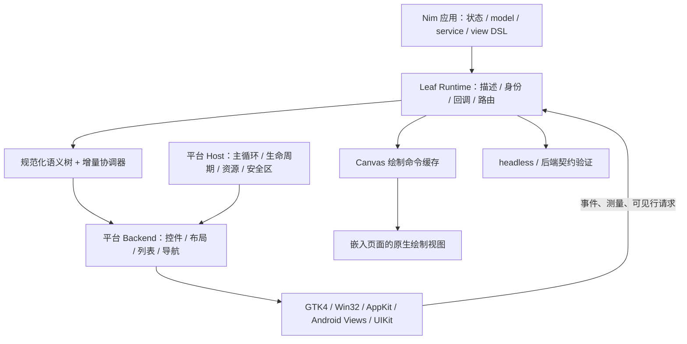

# Leaf 原生控件与局部自绘架构设计草案

日期：2026-10-07。状态：供用户审阅，尚未进入实现。

本设计以当前仓库 `07f2a0d` 为基线。用户已选择：常规表单、列表、导航使用平台原生控件，图表及特殊视觉区域局部自绘；应用状态、页面描述、事件和业务逻辑继续由 Nim 编写，最终移除 Rust / GPUI 依赖。

用户已确认首批平台为 **Windows + Android**。先以这两个平台贯通同一套 Nim 业务与组件协议，再扩展其他平台。完整目标涵盖 Windows、Android、iOS、Linux、macOS，各后端单独达到验收条件后才列为支持平台。本文是总体架构和阶段边界，不是已经验证的跨平台支持声明，也不是逐项执行计划。

## 1. 目标与取舍

成功标准：同一套 Nim 应用能描述原生表单、惰性列表和页面导航；稳定身份下的局部更新保留输入状态；图表能嵌入这些原生页面；headless 仍可验证业务、路由与组件描述；新后端的构建发布路径不需要 Cargo。

Leaf 需要维护共用组件协议和各平台适配器。控件的编辑、文本排版、焦点、滚动和基础无障碍行为尽量交给平台。原生控件不会自动解决受控值同步、列表复用、跨平台布局和应用生命周期，这些仍是 Leaf 的责任。

三种实现路线的取舍：

| 路线 | 优点 | 成本与结论 |
| --- | --- | --- |
| 共用 Nim 语义树 + 各平台原生适配器 | Nim 掌握应用；手机与桌面使用各自控件体系 | 多个平台适配器需要长期维护；选择此方案 |
| 桌面统一使用 GTK / Qt，手机另接原生 | 桌面接入较快 | 仍有两套语义与生命周期；不作为总体底座 |
| 共用 Skia 等自绘引擎实现全部控件 | 外观与绘制路径易统一 | 需要重建输入、控件、导航与无障碍体系；不符合已选方向 |

设计接受平台外观差异：相同组件表达相同意图，不保证像素一致。Android 页面和桌面页面可使用不同布局组合，复用 model、service、页面状态和大部分控件描述。首版不建设完整 CSS/Flexbox 引擎，不引入 Flutter、QML 或 WebView。

## 2. 仓库现状与保留边界

| 现有模块 | 现状 | 重构方向 |
| --- | --- | --- |
| `src/leaf/core.nim` | Nim Node、稳定身份、回调、候选树校验、缓存、惰性行构建 | 保留主体；增加候选提交边界、后端中立属性及新节点 |
| `widgets.nim`、`view.nim` | 构造器与 `view:` DSL 本身用 Nim 实现 | 保留常用调用；新增导航、滚动容器、Canvas |
| `routing.nim` | 命名路由、懒创建 PageGroup；目前没有历史栈 | 保留注册与状态保留；增加 push / replace / pop |
| `gpui_styles.nim` | GPUI 样式键与取值校验 | 拆出公共布局和能力校验，GPUI 兼容层暂保留 |
| `desktop.nim`、`gpui_api.nim`、`gpui_bridge.nim` | 动态库、同步 C ABI、完整 JSON 描述与请求 | 收入旧后端；新增统一 Host / Backend 边界 |
| `build.nim`、`gpui_build.nim`、`pack.nim`、`sdk.nim`、`doctor.nim` | 构建、打包和 SDK 明确依赖 GPUI | 按 target / backend 选择工具链、依赖与产物 |
| `headless.nim`、诊断及 ORM | 业务与数据能力；ORM 通过 executionScope 绑定连接 | 保留语义；补充移动平台路径、SQLite 链接及生命周期 |
| 脚手架与 Gallery | 导航多为按钮组合；CRUD 列表并非全部惰性；尚无 Canvas 节点 | 用真实导航容器、稳定键列表和局部 Canvas 改写示例 |

重要限制：当前 `refreshImpl` 能在候选树失败时保留已发布的描述和回调，但不会撤销事件闭包对业务对象的修改。原生控件提交也不是数据库事务。新架构不得将这两者描述成自动业务回滚。

## 3. 总体架构



**Runtime** 管理 Nim 闭包、稳定身份、应用执行作用域和已接受的 UI 描述。业务状态只在这个边界访问。

**协调器** 规范化属性，比较前后描述，产生 create / update / move / remove 操作；不逐帧重建全部原生控件。原生实体与 MountedNode 分开存放，原生对象不进入可序列化快照。

**Backend** 维护节点到原生实体的映射，执行批量更新，适配控件行为、测量和事件。一个语义节点可以映射为少量原生控件组合，例如标签加开关。

**Host** 管理桌面窗口或手机 Activity / Scene、平台主循环、资源位置、内容尺寸、安全区、键盘遮挡和挂载状态。桌面 run 阻塞运行；手机由系统回调驱动，Nim 不另开主循环。

**Canvas** 是原生容器中的一个局部视图，仅重放缓存的绘制命令。原生按钮、输入框与列表不会被转成 Canvas 绘制。

headless 使用同一 Runtime 和公共属性校验；增加记录型 Backend 验证协调行为。它不声称模拟输入法、屏幕阅读器或手机生命周期。

拟新增的源码边界如下，旧文件先由兼容入口转发，不要求第一步重命名所有模块：

```text
src/leaf/styles.nim                 公共属性规范化及能力校验
src/leaf/backend.nim                Backend / Host 契约与能力描述
src/leaf/reconcile.nim              实体身份与差异批次
src/leaf/canvas.nim                 绘制描述、资源及命中语义
src/leaf/backends/headless.nim      记录型后端
src/leaf/backends/gtk4/             Linux 适配
src/leaf/backends/android/          Nim 端接口
src/leaf/backends/uikit/            iOS Nim 端接口
src/leaf/backends/appkit/           macOS Nim 端接口
src/leaf/backends/win32/            Windows 适配
src/leaf/backends/gpui/             旧后端的内部入口
native/android/                    通用 Kotlin / JNI 宿主
native/apple/                      Objective-C 宿主与适配
```

`leaf` 的公共导出保持现有习惯；runner 按构建目标选择后端。headless-only 编译使用独立编译开关隔离平台导入，现有运行时 `--headless` 仍保持含义。CLI 已知使用 headless 时选择该构建路径。

## 4. 平台适配选择

以下是拟采用的 API，不是已实现能力。

| 平台 | 原生控件与容器 | 列表 / 导航 | 局部绘制 | 必要桥接 |
| --- | --- | --- | --- | --- |
| Linux | GTK4：Entry、Button、CheckButton、Switch、Box | ListView；Stack 与原生导航选择控件 | DrawingArea + Cairo | Nim 调用 C API；必要时少量 C 辅助 |
| Android | Views：EditText、Button、CheckBox、Switch、LinearLayout | RecyclerView；Fragment 页面宿主与系统返回分发 | 自定义 View + Canvas | 通用 Kotlin 宿主 / 适配器 + JNI C 边界 |
| iOS | UIKit：UITextField、UIButton、UISwitch、UIStackView | UITableView；UINavigationController、UITabBarController | UIView + CoreGraphics | Objective-C 通用适配器 + C ABI |
| macOS | AppKit：NSTextField、NSButton、NSStackView | NSTableView；原生侧栏 / 页面容器 | NSView + CoreGraphics | Objective-C 通用适配器 + C ABI |
| Windows | Win32 Unicode 控件：EDIT、BUTTON、公共控件 | 原生简单列表；复合行使用滚动宿主加原生子控件；原生页容器 / 导航选择控件 | 绘制子窗口 + Direct2D | Nim 调用 Win32；必要时 C 辅助 |

GTK 是 Linux 选用的原生工具包，不代表所有 Linux 桌面环境有完全相同的系统外观。[GTK ListView](https://docs.gtk.org/gtk4/class.ListView.html) 提供可见行工厂机制；[DrawingArea](https://docs.gtk.org/gtk4/class.DrawingArea.html) 提供 Cairo 绘制回调。

Android 的 [RecyclerView](https://developer.android.com/develop/ui/views/layout/recyclerview) 作为行复用机制；JNI 层采用批量传递，以减少跨语言调用与数据转换。[Android JNI 指南](https://developer.android.com/ndk/guides/jni-tips)

iOS 接入选用 [UITableView](https://developer.apple.com/documentation/uikit/uitableview) 和 [UINavigationController](https://developer.apple.com/documentation/uikit/uinavigationcontroller)；macOS 接入选用 [NSStackView](https://developer.apple.com/documentation/appkit/nsstackview) 等 AppKit API。

Windows 公共控件属于系统提供的子窗口体系。[Win32 公共控件](https://learn.microsoft.com/en-us/windows/win32/controls/common-controls-intro) 对任意复杂行，传统 ListView 不能直接承接现有任意 Node 子树；因此明确保留“原生滚动宿主 + 复用原生行控件”的适配工作，不能只换成一个 ListView 就宣布支持完成。

没有一一对应的控件使用原生组合：iOS 的 checkbox 可映射为带选中状态的原生 UIButton；传统 Win32 的 switch 使用复选控件；tag 使用原生文本与容器；spinner 可用平台的不确定进度控件。能力表说明对应关系，不为统一外观重画普通控件。

普通应用作者继续写 Nim。Kotlin / Objective-C 是框架维护的通用宿主和适配器；接入平台特有组件时才扩展它们。完全零辅助语言不是本设计的目标。

## 5. 组件与布局契约

现有 `column`、`row`、`text`、`button`、`input`、`checkbox`、`switch`、`progress`、`tag`、`separator`、`spinner`、`virtualList` 保留。`view:` 继续展开成 Nim 构造器。新增加三个边界明确的组件：

- `scroll`：普通内容的原生滚动容器；不承担大列表虚拟化。
- `navigation`：引用 Router 及导航模式，产生页面栈 / 页签 / 桌面导航描述；页面来自原有 PageGroup。
- `canvas`：绘制源、尺寸和无障碍描述；通过 Nim 绘制回调生成命令缓存。

下列示例仅说明拟议接口，尚不能在当前版本运行；现有 `input` 和回调形式不需要更换：

```nim
view:
  column(key = "profile"):
    text("个人资料")
    input(state.name, key = "name", onChange = proc(e: Event) =
      state.name = e.value)
    switch("接收通知", state.notifications, key = "notifications",
      onChange = proc(e: Event) = state.notifications = e.checked)
    button("保存", key = "save", onClick = proc(e: Event) = saveProfile())

# 图表单独提供绘制回调，事件与业务状态仍在 Nim。
# canvas(key = "sales", paint = paintSales, ...)
# navigation(router, mode = adaptive, ...)
```

属性规范化后使用有类型的 Layout、ControlProps 和 AccessibilityProps。旧字符串 `Styles` 先经过兼容转换；后端不各自解析任意字符串。旧属性合法并不意味着每个后端都能表现该效果。

### 布局最小公共集合

首版共用行 / 列、间距、内边距、auto / fixed / fill 尺寸、主轴与交叉轴对齐，以及普通滚动和裁剪。逻辑尺寸按平台转成 dp / pt / DIP；默认字体、控件最小触摸尺寸和辅助功能字体缩放遵循平台。

`full` 转为父容器剩余空间内的 fill，不是无限尺寸；`flex_grow` 的非负值转为剩余空间权重。旧 `flex_shrink`、around / evenly 对齐、min/max 等超出首版公共集合的属性需要后端明确声明支持；不默默近似为另一种布局。超出可用区域时遵循容器的裁剪 / 滚动策略，不强制压缩原生控件到不可交互尺寸。

GTK、Android、UIKit 和 AppKit 优先使用平台布局容器与原生测量。Win32 缺少通用行列容器，需要一个小型线性布局辅助器，基于原生测量分配子窗口位置。它仅实现约定的公共集合，不扩展成完整浏览器布局引擎。

布局复用保证阅读和交互语义，不保证各平台测量数值完全一致。手机内容采用系统提供的可用内容区域，导航栏、安全区和软键盘由 Host 提供；可使用可用宽度选择页面组合，无需在业务里识别操作系统名称。

### 外观与能力

`variant` 表达 default / primary / danger 等语义意图。支持者映射为原生强调或状态样式；不支持的具体装饰由能力校验报告。普通控件默认保留平台主题、焦点指示与高对比行为。

对 `background`、`radius`、`border_width`、`opacity` 等旧装饰属性，默认模式报告一次结构化“不支持该属性”诊断并使用原生默认外观；strict 模式在挂载前拒绝。未知属性和非法取值始终报错。一个语义意图的原生等价映射属于已声明能力，例如 switch 的复选控件映射，不等同于忽略属性。

首版必需的控件、布局、列表、导航、Canvas 能力缺失时直接拒绝运行该页面。仅装饰性属性允许上述降级。业务不依赖 GPUI 色值来表达“错误”或“禁用”；这些应进入控件语义属性。

## 6. 身份、增量更新与提交

沿用父路径 + sibling key 的稳定身份。相同父节点下，相同 key 且类型相同的节点复用原生实体；类型改变、移动到其他父节点或卸载后重建，视为新实体。动态表单与列表必须使用显式 key；无 key 的节点继续按位置匹配。重复 sibling key 仍拒绝。

正常更新流程：

1. Nim 事件执行，按现有 executionScope 进入应用数据库等上下文。
2. Runtime 生成候选描述；公共属性、能力和资源校验通过后计算差异。
3. Backend 准备新增实体及必要的可见行；准备阶段不改动可见控件、不执行业务回调。
4. 在所属 UI 线程批量应用更新，抑制属性写入引发的通知；成功后发布候选描述、回调索引及 accepted revision。
5. 退出提交区，再处理排队的真实用户事件和测量请求。

`core.nim` 需要将目前绑定在 `refreshImpl` 内的准备与发布拆开，使后端确认成功前不替换 Runtime 的已发布索引。不要直接把可见控件写入放进当前 RuntimePreparer；它已有不改动可见控件的约束。

可预检的失败保留旧描述及旧界面。原生 setter / 宿主在实际应用阶段意外失败时，冻结事件并尝试从旧的已接受描述重新挂载；重挂载可能丢失原生临时输入状态。恢复也失败时进入明确的错误状态，禁止半更新界面继续触发业务回调。不得承诺跨平台原生控件修改具有完全原子回滚。

这不回滚之前已经发生的业务修改；数据库事务和编辑草稿隔离沿用现有 ORM / 应用约定。

重绘仅读取已接受控件状态和 Canvas 缓存，不重新执行整个业务 render。Nim render 仍在事件或显式应用更新时执行；变更单个输入值不能销毁页面内全部输入框。

## 7. 跨语言、线程和所有权

后端采用编译期选择，避免一个应用加载五套工具包。Nim 可直接调用的平台使用同一 Backend 接口；跨 JNI / Objective-C 边界使用内部版本化 C ABI。旧 GPUI ABI v1 仅留在旧后端，不用新协议假装兼容。

新边界包含 session、mount generation、节点 handle、操作批次及结构大小 / 协议版本。handle 是受检查的不透明 ID，不是对端可解引用的 Nim 对象地址。回调闭包始终留在 Runtime。

协议传递有类型的操作和 UTF-8 字符串数据；固定宽度数值和字符串 offset / length 与批次缓冲区配套。Android 一次 JNI 调用提交一个操作批次，不按每个控件属性往返调用。第一版采用显式复制的拥有型缓冲区，不把零复制当作前置目标。JSON 保留给 headless、诊断和可读快照。

Nim 分配的批次由 Nim 的释放函数回收；原生端留存前复制所需数据。原生对象、JNI 引用及绘制资源由对应 Backend 拥有；卸载时释放，旧 handle 不能复用为有效新 handle。C ABI 入口捕获可处理异常并返回结构化错误，异常不得穿越 FFI 边界。

所有 Runtime 闭包、控件提交、列表行构建均在所属平台 UI 线程运行。原生通知进入队列，禁止在一次提交中递归 dispatch；后端 setter 引发的通知不当作用户输入。长查询和计算不放进同步 UI 回调；后台结果以数据消息回到 UI 线程后再修改状态，不能直接共享 UI 闭包或数据库连接。

事件携带 session / mount generation / handle / 顺序号以及已观察 revision。处理时检查实体仍挂载、处理器存在且没有被禁用。监听器不会因为其他节点更新而失效；不能简单地拒绝所有旧 revision 事件。卸载、行换绑和会话重建通过 generation 使旧通知失效，单会话用户事件按顺序处理。

## 8. 原生输入框契约

保留 `value + onChange` 的受控输入接口，区分模型值、原生编辑中的值和最后一次已接受值。

- 原生编辑产生 `onChange`，业务返回同一文本时不调用重置文本的 setter，保留光标、选区、平台撤销状态和输入法组合。
- 增加可选的 composition phase 事件信息；旧回调继续读取 `e.value`。组合期间的程序值冲突暂存，组合结束后应用最终已接受模型值；应用可显式要求取消组合并重置。
- 非组合期间业务明确拒绝 / 转换输入，按模型值同步一次，并通过平台 API 合理恢复选区；不承诺不同平台的撤销栈完全相同。
- 稳定 key 下的无关节点更新不能结束编辑；改变节点身份或移除输入框可以结束编辑。
- submit 映射桌面确认键或手机键盘动作，行为由 input 的提交意图配置；程序 setText 不能再次派发用户 change。

UI 错误时暂存的冲突值只随成功接受的候选提交更新，不能把被拒绝候选中的值写回输入框。

基础无障碍属性包含 label、hint、role、value、enabled 等；优先使用原生控件自身的语义。手机键盘遮挡后的滚动由 Host 与滚动容器协调，不用全局修改业务布局高度。

## 9. 原生列表与复用

沿用 `virtualList` 的稳定 item key、RowBuilder、generation、固定 / 估算行高和可见行按需构建。平台列表负责滚动与原生实体复用；Nim 负责行描述和回调。不在启动时把所有行变成控件。

GTK / Android / UIKit 等的行工厂或 data source 请求通过统一列表入口取得描述；请求必须有列表 handle、source generation 和 item key。不能只靠行号绑定事件，因为排序和插入会改变位置。

需要同步绑定的原生行请求可以调用受控的描述构建入口，但不能递归派发用户事件或触发完整 refresh。准备阶段从隔离候选读取行，已提交界面的视口请求从已接受 Runtime 读取；二者的索引和回调发布边界不能混用。构建失败交给统一错误路径，不在原生 data source 回调中泄漏异常。

行槽换绑时解除旧监听器、焦点关系及 transient state，增加绑定 generation；输入值、选中状态等重新设置，避免前一项的状态泄漏。聚焦且正在组合输入的行在能力范围内保留；确需回收时先结束编辑并通知 Runtime，不把编辑状态交给另一条数据。

原生可见范围与复用触发是视口事实来源；`height_index.nim` 的估算辅助定位，不同时建立第二套冲突的滚动权威。保留有限的行描述暖缓存和既有预算；实体池按可见区与有限预取增长。仍保留当前 100,000 项上限，不将它宣称为数据量无上限。

脚手架 CRUD 列表迁移为按数据库 id 生成稳定 key 的 virtualList；这解决控件构建量，不自动改变数据库查询为分页。服务层分页和流式数据源属于后续独立扩展。

## 10. 路由与原生导航

保留 Route / PageDefinition / PageGroup，新增由 Nim 管理的导航历史栈。`navigate` 保留“选择当前路由”的兼容语义；明确提供 push / replace / pop 表达手机历史行为，不把旧所有跳转都自动变成 push。

`navigation` 输出导航模型，Backend 使用原生容器：手机可选择 stack 或 tabs；桌面使用侧栏 / 选项卡和页面宿主。adaptive 的首版规则是手机窄内容区域采用 stack，宽内容区域采用侧栏；重要页面可显式选模式。

系统返回键、导航按钮和返回手势产生一次 Nim 导航请求；Nim 计算目标并准备成功后，原生栈才确认变化。平台的过渡完成通知仅用于确认，不能再次 pop。取消的交互返回保持原路由和栈。返回到根页面时交给 Host 的平台退出 / 关闭策略。

导航历史变化先保存为待提交提案，原生过渡取消或候选失败时丢弃；确认成功后才替换已接受的历史栈。页面业务对象仍遵守前述不自动回滚约定。过渡期间的后续导航请求排队，不同时修改同一个原生栈。

PageGroup 的业务状态仍懒创建并保留。原生页面实体可以按当前页面和有限相邻页面缓存；重新挂载页面不等于丢失其 Nim 状态。导航会话与过渡请求使用 generation / request id，防止快速连续返回产生双重提交。

首版不增加 URL 深链、独立多窗口导航或自动序列化任意页面闭包；这些扩展不影响当前路由契约。

## 11. 手机入口、生命周期与数据

Android 由框架提供通用 Activity / Fragment 宿主，Nim 编译为应用本地共享库；iOS 由 UIKit 应用宿主驱动，Nim 应用代码链接进原生应用。应用用工厂创建 Application，不将当前桌面 `quit(run(createApplication()))` 作为手机入口执行。

拟新增应用工厂注册入口，构建器生成薄的启动胶水。宿主在 UI 线程初始化 Nim runtime 一次，再创建会话、挂载内容。桌面入口继续支持 run；headless 可直接用同一工厂创建应用。

会话状态区分 created、attached、active、suspended、detached、disposed：

- 暂停后停止非必要视觉刷新；进入前台重新同步尺寸和主题。
- Android 配置变化导致 Activity 重建时，进程内 Nim 会话由生命周期 holder 保留；旧控件全部释放，新宿主重新挂载已接受描述，避免持有旧 Activity。
- 进程被系统回收后从应用工厂重建；只有应用显式保存的可序列化状态和数据库记录可恢复。提供可选 save / restore state 钩子，不自动序列化 Nim 引用或闭包。
- dispose 后释放回调、控件映射、JNI 引用和平台资源；过期宿主事件不能进入新会话。UI detach 不自动关闭仍存活会话的数据库。

移动系统会暂停、重建界面或终止后台进程，因此生命周期是独立宿主能力。[Android Activity 生命周期](https://developer.android.com/guide/components/activities/activity-lifecycle)

目前 `asset()` 假设资源位于可执行文件旁，`sqlite_native.nim` 和 `orm_config.nim` 选择桌面动态库名。手机接入必须一起替换：Host 提供只读资源读取和可写应用数据目录；Android assets 可按需提取给必须使用文件路径的调用者；iOS 读取 bundle 资源。数据库与迁移记录写入应用数据目录，SQL 迁移资源保持只读。

Android 首版随应用编译并链接 SQLite；iOS 使用 SDK 提供的 SQLite 链接方式。Leaf 自有绑定及 Norm / lowdb 使用同一套 SQLite 配置，避免同一 handle 在不同 SQLite 实现间混用。ORM API 与 executionScope 不改；编译选项、连接启动、资源路径、64 位主键及保存读取都必须在手机上实测，不能由桌面 ORM 测试推断支持。

## 12. Canvas 自绘契约

新增有限的、与平台无关的命令集合：保存 / 恢复状态、裁剪、变换、矩形、路径描边与填充、文本和图片。Nim paint 回调以局部逻辑坐标和实际内容尺寸生成不可变 DisplayList；资源使用有版本的不透明 handle。命令、路径点数及图片资源有独立大小预算。

数据、尺寸、缩放或主题变化时，只使相关 Canvas 缓存失效。回调在 Runtime 的 UI 执行作用域中运行；系统原生 paint / draw 回调只重放缓存，不进入业务 render。连续动画如需启用，由 Host 提供显式帧调度，后台暂停。

文本使用平台字体排版；不要求跨平台字形和度量完全一致。首版不要求 Skia，不开放任意 shader，也不将文本编辑器变成绘制命令。各平台绘制 API 的 CPU / GPU 路径不同，不能据此承诺统一 GPU 加速或固定性能。

可交互图表提供局部 hit region、点击事件和可访问的文字摘要；交互区域映射为平台无障碍元素。只是装饰的图形标记为无障碍隐藏。缩放与滚动后的命中坐标必须经过同一变换；普通表单输入仍由外部原生控件承担。

首个验收样例是一张可随窗口宽度变化的折线图，与原生列表、输入框同处页面。大型实时图表、复杂图形编辑器和通用图表组件库留作独立工作。

## 13. 构建、SDK、配置与发布

建立 Target / Backend 构建描述，列出编译器、原生依赖、链接配置、宿主模板和发布产物。build、pack、doctor 和 SDK 都使用它，不再分别写死 GPUI 文件名。

过渡期配置增加可选 backend；桌面默认仍为旧 GPUI，避免已有项目一升级就换控件行为；手机目标默认 native，显式选择 GPUI 时拒绝构建。使用 native 可显式选择目标后端。原生后端达到最终迁移阶段的验收要求后，在明确标示兼容性变化的版本切换桌面默认，再移除旧后端。

`leaf.json` 的严格字段校验保留，同时扩展 android / ios 平台配置；旧配置无需添加字段即可继续构建。图标、原生宿主元数据、应用版本和资源路径采用平台配置；凭据与签名私钥不写入 manifest。

拟支持的命令形态是 `leaf build PROJECT --target android --backend native`、`leaf run PROJECT --target android`、`leaf pack PROJECT --target android`；具体旗标在执行计划中与现有 CLI 兼容性一起定稿。现有桌面命令继续有效，移动运行目标需设备或模拟器。

| 目标 | 构建和发布边界 |
| --- | --- |
| Linux | Nim + GTK4；声明系统依赖，或采用单独经过验证的分发封装 |
| Windows | Nim + Win32；沿用 DPI / manifest 能力，发布包不带 GPUI DLL |
| macOS | Nim + Objective-C 适配层；AppKit 应用包与平台签名流程 |
| Android | Nim 本地库 + NDK + Gradle 通用宿主；调试 APK，发布 AAB |
| iOS | Nim 库 + Objective-C 宿主 + Xcode；模拟器应用，签名归档 |

移动首版以 arm64 为设备目标，另外提供测试需要的模拟器 ABI；架构不匹配必须在工具链校验阶段报告。Android / Apple SDK 属于外部平台工具链，Leaf SDK 提供模板、依赖配置和诊断，不承诺包含或跨系统替代完整 Xcode。

当前 `pack --target all` 保持三个桌面目标的含义，避免旧脚本突然要求手机工具链。移动目标显式指定。release、SDK 离线检查、许可证清单、doctor 和性能工具都按后端更新；headless-only 编译与测试不得导入或链接图形工具包。

## 14. 分阶段迁移边界

这是总体交付顺序。每个后端阶段独立设计和验收，不一次性提交五个平台的未经验证实现。

| 阶段 | 范围 | 完成标准 |
| --- | --- | --- |
| A：共用边界 + Windows 原生纵向样例 | 公共属性、Host / Backend、增量协调、候选提交；Win32 表单、线性布局、复合行池、导航与 Direct2D Canvas；沿用 DPI / manifest；GPUI 暂作旧后端 | Windows 上完整跑通一次带数据库的表单编辑、列表滚动、页面返回和局部图表；中文输入与 DPI 切换正常；native 构建及发布包不依赖 GPUI DLL / Cargo；旧后端和 headless 无回归 |
| B：Android 与 Windows 贯通 | 通用宿主、JNI、Views、行复用、系统返回、安全区 / 键盘、配置重建、资源 / SQLite | 与 Windows 共用同一套 Nim 业务和组件契约；真机完成保存重开、中文输入、长列表和旋转重建；调试 APK 可安装运行且构建不依赖 Cargo；修正公共协议中桌面特有假设 |
| C：iOS | UIKit 宿主、列表 / 导航、组合输入、资源 / SQLite、Canvas、模拟器与设备构建 | 同一业务应用完成输入、返回及恢复验证；有可复现的设备或模拟器测试证据 |
| D：Linux / macOS | GTK4 与 AppKit 原生适配器、宿主、列表 / 导航与局部绘制 | 现有桌面示例与发布链路通过实际原生窗口验证，不只通过 headless |
| E：应用迁移与默认切换 | Gallery、两套 CRUD 脚手架、文档、SDK / release / 性能场景迁移；删除 GPUI | 全部承诺目标达到验收，native 成为默认；源码、SDK 和 CI 不再依赖 Cargo / Rust / GPUI |

最先详细设计并实现的是 A；B 紧随其后，手机输入与生命周期尽早反馈到公共边界。A + B 构成首批交付，不等待其他平台完成。C 与 D 的相对顺序可按后续产品优先级调整，不改变总体架构。

首批贯通样例包含原生表单、可编辑复合列表、页面导航和折线图，Windows 与 Android 共用 model、service、页面状态及组件描述，仅对宿主和布局组合做必要适配。Windows 原生测试在 Windows runner / 实机执行，Android 宿主测试在模拟器及真机执行；当前 Linux 开发环境只能验证公共核心，不能代替这两个平台的原生验收。Win32 行池和线性布局是 A 阶段的必需工作，不推迟到后续平台阶段。

GPUI 保留期间只提供迁移对照与既有项目兼容，不追加新产品功能。既有源码/API 尽量兼容；依赖 GPUI 装饰和布局细节的页面必须处理能力诊断，不承诺完全无修改迁移。

## 15. 验收与风险

测试按责任分层：

| 验证层 | 必须覆盖的行为 |
| --- | --- |
| Nim / headless | 现有 core、view、routing、model、SQLite、脚手架测试；公共属性、稳定身份、导航历史、Canvas 命令合法性 |
| 记录型 Backend | 无关更新不重建输入实体；实体移除 / 换绑后事件失效；失败候选不发布；setter 通知不会递归 dispatch；列表不全量建行 |
| 原生集成 | 中文 / 日文组合输入、光标与选区；键盘 / 屏幕阅读器基础导航；行复用和输入隔离；系统返回只执行一次 |
| 手机宿主 | 旋转重建、前后台、键盘遮挡、过期宿主通知、应用数据路径；进程重建按显式恢复策略运行 |
| 发布 | 桌面包移机运行；Android / iOS 原生编译、资源和数据库；架构检查、平台依赖与许可；native 路径无 Cargo |
| 性能 | 稳定输入更新的实体创建数为零；10,000 项列表实体池按视口增长；记录 UI 线程耗时、帧耗时、内存及 JNI 批次量 |

性能目标首先是避免全量重建和不必要跨语言调用。不能在缺少实测前承诺原生一定快于 GPUI。现有 Linux SwiftShader 窗口验证证明软件 Vulkan 路径能运行，不是新后端 GPU 性能基线。

主要风险是多后端维护成本、原生控件的样式差异、Win32 任意复合行、受控输入与输入法的冲突，以及移动构建和数据生命周期。对应措施已经分别进入能力校验、列表绑定、输入契约、Host 和平台验收；没有通过验收的平台不进入支持清单。

本轮只新增这份设计草案，不改变实现或现有构建行为。进入实现前，需要先审阅总体边界，再为 A 阶段形成可执行计划。
