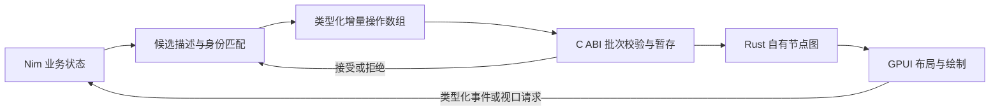

# GPUI 类型化增量桥接与性能优化设计

状态：历史候选草案，已由 [Leaf React 式组件运行时与增量宿主设计](2026-10-12-react-runtime-design.md)
替代；以下保留方案讨论记录，不作为当前实施依据。尚未实施产品代码或承诺性能收益。

审阅修订：用户质疑为何需要 Rust 再保存节点图。该质疑成立：去掉 JSON 与消除整树传输
不必绑定到 Rust 可变镜像图。本草案第 4–10 节保留为“Rust 镜像图”候选的详细设计，
不代表已经选定的最终架构。新增优先比较的候选为“Nim 持有不可变 C 兼容渲染描述，
Rust 通过有生命周期的批量视图消费”；比较结论与最终实施范围尚未批准。

新的选择依据：GPUI 仍需在重绘时取得描述，但不要求桥接层保存可变图。
已有业务 Node、跨语言描述与 GPUI 自身布局/控件状态应分别计入成本，不能把扁平化描述
称为没有数据结构或没有全树工作。Nim 描述方案需明确 acquire/release、版本保留、
列表行 provider 生命周期和旧帧引用；不能直接暴露现有 Nim ref/seq/string。
两方案须比较描述准备、FFI、GPUI 元素构建、字符串复制和内存峰值的总成本，
不能仅凭无 JSON 或少一次复制认定性能最优。

基线：`a00191bcf702c1ef39ad5d06cc57431a03605e4c`。

## 1. 目标与范围

用户已要求按架构分析优化，并特别要求重新设计整树 JSON 到 Rust/GPUI 的路径。
本设计把桥接重构作为第一批工作；其余已识别的优化保留在后续批次。

第一批目标：

- GPUI 新路径的初始化、事件、列表、状态、就绪和帧测量通信不生成或解析 JSON。
- 首次挂载传全量描述，后续仅传新增、删除、移动和属性变化。
- Rust 持有自己的、按稳定句柄索引的节点图，避免通过重新生成嵌套快照消费增量。
- 不改变 Nim 应用的 `view`、组件、事件、`cached` 和虚拟列表 API。
- 保留成功界面、回调与接受版本的一致性，保持输入、焦点、选区、IME 和列表锚点行为。
- 保留旧 ABI 1 的兼容路径；正常配套的新 SDK 默认选择新路径。

JSON 仍可用于项目配置、诊断输出、headless 导出及旧版兼容。这些用途不属于新桥接热路径。
本批不承诺消除 Runtime 的全树 render/mount/inspect，也不宣称消除 GPUI 自身布局和绘制成本。

## 2. 当前证据

当前源码 Release/ORC 实测：5004 节点、静态子树缓存命中、仅增加计数，Nim 更新并生成响应 JSON
中位约 8.074 ms，响应约 978586 字节；无业务变化的 status 生成响应也需约 6.121 ms。
以上尚未包括 Rust 解析及 GPUI 帧成本。

代码中的重复工作：

- `gpui_bridge.request` 的所有响应附带完整 snapshot，list 还附带重复的 rows。
- Rust 先解析为 JSON Value，再把 snapshot 转回字符串并解析校验，最后又构建 Response。
- GPUI 样式使用字符串表，绘制时重新解析数字和颜色。
- Rust 的嵌套 Node 结构与树查找不适合直接消费后端增量协议。

前次测量文件位于 `/tmp/leaf-architecture-audit/`。实施时需把有效基线、测量程序和环境元数据
保存到功能工作区以外的持久验收目录，不能依赖 `/tmp` 长期存在。

## 3. 方案比较

| 方案 | 收益 | 代价与局限 | 决策 |
| --- | --- | --- | --- |
| 用紧凑二进制替换整树 JSON | 减少文本编码和解析 | 仍按整树规模传输、分配和替换；还需维护编码格式 | 不作为目标架构 |
| 使用 FlatBuffers 等格式传增量 | 可用 schema 和结构化 buffer | 需增加格式工具链及 Nim 侧集成；当前同进程同步 FFI 没有存储或网络需求 | 有跨进程需求时再评估 |
| 类型化 C ABI 数组传增量，Rust 保存镜像图 | 没有 JSON AST/文本解析；只复制变化数据；沿用现有 C ABI | 双侧描述与接受状态同步、批次事务、额外图维护成本 | 保留候选，尚未选定 |
| Nim 持有不可变 C 兼容描述，Rust 批量读取 | 没有文本编码解析；无需 Rust 可变镜像图与补丁应用；可复用不变描述块 | 需要严格的版本/借用生命周期；GPUI 元素构建仍需遍历与必要复制 | 优先比较的候选 |

这些候选针对当前同进程、同步调用的架构，不声称 C ABI 在所有场景下优于序列化协议。
单节点一次 FFI 调用也会产生过多调用开销，因此采用操作数组批量提交。

## 4. 数据流

初始化是一个从空图创建所有节点的批次。后续短文本计数更新通常只包含一个节点的完整属性更新；
不必在第一版再引入属性级 delta。删除属性通过完整属性里的 presence mask 恢复默认值。

不变化的节点继续使用原句柄。更换种类或更换祖先会遵守现有 Reconciler 的实体替换规则。
Rust 使用 `NodeHandle -> RenderEntity` 索引及每个父节点的有序子句柄数组；不每次重新拼装嵌套 Node。

## 5. 类型化边界

新增 ABI 2 入口及版本化函数表，不更改现有 `leaf_gpui_abi_version()` 返回值和 ABI 1 符号。
ABI 2 用独立查询函数协商协议版本、结构大小和能力；找到 ABI 2 但协商失败必须报错，
不能把损坏或不兼容的新库静默当作旧库使用。

ABI 定义的 C header 为合同来源，Rust 用 `#[repr(C)]`，Nim 用 C 兼容声明，并在实际编译器下
验证 sizeof、alignment、offsetof、数组 stride 和回调调用约定。公共字段不使用 Nim ref/seq/string、
Rust String/Vec/Option 或语言默认 enum/bool 布局。

| 描述 | 必需内容 |
| --- | --- |
| API header | 协议版本、结构大小、能力位；保留字段必须为零 |
| 字节视图 | 指针与明确长度；不要求 NUL 结尾 |
| Batch | session、mount generation、base revision、next revision、批次 token、root handle、数组长度和数据预算 |
| Operation | 固定整数 tag、handle、parent、目标 index、属性记录索引 |
| Properties | presence mask、布局数值、维度 tag、RGBA、控件值、variant、事件位；列表描述和行元数据 |
| Request | event/list/status/locate/ready/rendering/frame 的固定整数 tag 及对应类型化载荷 |
| Receipt | 结果码、接受 revision、可选定位结果、就绪能力和 UTF-8 错误信息 |

节点句柄和版本使用 uint64；协议 tag、索引和数量使用有界固定宽度整数；字节长度和地址
在同进程 C ABI 中使用 size_t/指针。枚举按固定整数读取并检查范围，不直接转成 unchecked Rust enum。
总节点、深度、字符串、批次字节和列表项预算继续沿用框架限制；乘法与偏移计算检查溢出。
空数组仅允许零长度，非空指针的有效性是调用者的 FFI 合同；不能声称任意坏指针都可安全探测。

布局与装饰在 Nim 侧转成类型化值，Rust 不再逐帧 parseFloat/parseHex。GPUI `width: full` 继续映射
原有相对尺寸语义，不能误套 Win32 的剩余空间分配算法。

复用现有身份匹配、样式解析和更新语义，但不把现有 Native UpdateBatch 当作完整 GPUI 载荷直接发送：
当前 NormalizedProps 未完整表示列表 generation/count/行高/overscan、行 index/key 等信息，
Native 属性校验还比旧 GPUI 严格。须增加 GPUI payload 适配与相应差异比较，确保这些字段变化
会生成更新。public widget 的所有当前有效用法必须保持行为，未知的旧 GPUI 忽略属性不得意外
变为全局严格拒绝。非零 input reset token 继续明确拒绝，支持该行为是另一项功能。

## 6. 内存与异常合同

- Nim 批次数组和字节区仅在同步消费期间借用；Rust 在返回前把需要保留的变化数据复制到自己的所有权中。
- Rust 不保存 Nim 描述、闭包或借用字符串；事件回调仍由 Nim 的接受状态索引查找。
- 只复制变化数据不等于完全零拷贝；字符串所有权转换是有意保留的成本。
- 错误信息也有明确的调用期长度/生命周期，接收方立即复制，不保存跨下一次调用的借用。
- Nim 异常和 Rust panic 不跨 C ABI 展开。可恢复的验证/分配失败返回错误；不把进程 abort、
  OOM abort 或任意内存破坏列为可恢复能力。
- 所有消费和业务调度保持 UI owner 线程；本批不新增后台访问 Nim Runtime 的权限。

## 7. 接受边界与回调重入

新增 GPUI bridge session，持有 Reconciler、接受 payload、安装 hook 的 owner token 和 pending batch。
通过 Runtime 现有 committer/lifecycle 接入，避免另造绕开候选状态的接受路径。

普通更新顺序：

1. Rust 在不持有节点图借用或 GPUI 控件借用的状态下，向 Nim 发类型化请求。
2. Nim 执行业务回调并生成候选，身份匹配和 payload diff 生成批次。
3. Nim committer 同步调用 Rust consumer.stage；Rust 复制变化数据、验证结构和预算并暂存。
4. stage 成功后调用 consumer.commit(token)。commit 在修改 live 图前检查 token/base revision；
   所需资源与容量在暂存阶段准备，验证失败不得留下半应用的 live 图。
5. Rust 成功提交后 Nim 接受 plan，随后由 Runtime 发布候选。publish 不再调用外部业务代码。
6. 最外层请求返回后，Rust 同步受影响输入/列表实体，并安排绘制。

hook 安装有不同的生命周期：stage 后保持 pending，executionScope 完整成功退出后由 lifecycle.confirm
提交并接受；退出失败由 lifecycle.abort 丢弃 pending，保留旧接受状态。安装确认必须在发布前完成。
消费者 API 的 stage/commit/discard 仅操作渲染描述，不调用业务、窗口事件或 GPUI 控件 setter。

关键实现约束：consumer 的 transport store 必须是独立分配的对象，不借用正在执行 dispatch 的
`Desktop &mut self` 内部字段；调用 Nim 时不得持有其 RefCell borrow、mutex guard、图引用或迭代器。
这样嵌套的 Rust → Nim → Rust 校验不会别名访问同一个可变 Desktop。该约束必须有回归覆盖。

Rust 暂存使用变化节点和受影响父节点子序列的 overlay；提交将预先验证的内容应用到自有图。
不能用每次 clone 整张 HashMap 或重建整棵 Node 的方式换取原子性。单纯文字变更不全图验证拓扑；
结构变化验证受影响路径，根替换等必要情形允许全量检查。若 commit 的实现仍可能有 recoverable
中途失败，必须提供 journal 回滚并证明 old revision/图不变，不能只靠 catch_unwind 掩盖半应用。

拒绝批次时 Nim 不发布候选，Rust 不推进图版本；响应只有错误与接受版本，不重发旧整树。
故障恢复保持框架接受状态合同，不承诺回滚任意业务变量、已提交 SQL 或外部副作用。
遇到版本不一致，停止该 session 的进一步业务调度并报明确错误；不自动重放有副作用的业务事件。

## 8. 虚拟列表与输入

- 列表源 generation、count、rowHeight、estimatedHeight、overscan 使用独立类型化描述。
- 行请求带列表 handle/source generation、范围和受保护 item key；返回仅含行引起的增量与 receipt。
- Rust provider 从自有图取行，不复制一份 rows 再复制一份 snapshot。
- 固定行高按范围请求；变高列表对邻近可见行做有界预取和按帧去重，缓存命中不重复 FFI。
- 批量化不允许提前构建十万行；保留现有可见/受保护行和 warm cache 上限语义。
- 锚点与焦点仍按 item key 跟随来源重排，不按旧 index 猜身份。
- 输入实体继续按稳定 handle/identity 复用；同值响应避免 set_value，拒绝/格式化时同步接受值。
- IME 的现有 Rust InputState 状态机保持有效；新增协议不得以减少事件次数为由合并 composition、
  submit、click 或 reset。真正的同状态反馈和失败恢复也必须执行输入结算。
- ready 仅在初始图和首屏必需行成功后发布；status、locate、rendering diagnostics 不附带节点图。

## 9. SDK 与旧库兼容

新 Nim loader 优先选择成功协商的 ABI 2。旧库没有新入口时走原有 ABI 1；日志/doctor 显示实际协议，
避免回退后误判优化无效。新 Rust 库保留 ABI 1 给旧应用使用。

旧路径与新路径共享 GPUI 控件行为和可复用逻辑，使用隔离的传输适配器，不复制两套完整 Desktop。
JSON 仅由旧适配器消费；新路径的正常初始化、事件、行请求和诊断均不得调用 JSON 编码/解析。
新版本 SDK 发布必须配套新桥接库、ABI 声明与离线所需文件；混版本测试覆盖四种新旧组合。
帧测量 ABI 也新增类型化入口，避免只优化应用路径却继续用 JSON 测量另一条路径。

## 10. 验收

行为验收：

- Linux/macOS/Windows x64 的 C、Nim、Rust 实际编译布局核对；未执行的平台明确 NotRun。
- 初始挂载、增删改、移动、祖先替换、属性移除、列表源变化与行元数据传递。
- 空/越界/溢出载荷、非法 tag/UTF-8/数值、错误版本/代际、stale/重复 batch/token 全部拒绝。
- stage/commit 失败、scope 后置错误、关闭和 hook 释放不留下部分接受状态或悬空调用。
- Rust → Nim → Rust 嵌套消费无借用冲突；setter 不重入业务。
- 中文输入、IME、选区、受控拒绝、格式化、焦点行重排、首屏失败及 ready/watch 兼容。
- 新旧 ABI 混用、SDK 搬迁及实际加载库证明。

性能验收分层，必须重新建立 Rust 消费也纳入计时的旧路径基线：

1. 同一 5000 节点静态树、短计数文本变化，新路径更新载荷不超过 4 KiB，且不会随静态节点数增加。
2. 无变化 status/diagnostics 节点载荷为零，不调用业务 render，不推进 Runtime 接受版本。
3. 传输准备、跨 ABI 与 Rust 消费阶段的 P95 相比旧 JSON 路径下降至少 80%；
   完整同步事件链 P95 下降 50% 是目标，必须实测，达不到则继续定位而不宣称达到目标。
4. 单节点修改不复制整张 Rust 图；同时记录分配次数、复制字节、批次操作数和 FFI 次数。
5. 十万项固定/变高列表滚动、240 根 K 线、真实 CRUD 数据及普通表单不得有明显性能回退；
   变高列表预取记录每帧请求数、构建行数和缓存命中，不能以额外大量构建换取低 FFI 次数。
6. 硬件 GPUI 帧测量记录 P50/P95/P99、首屏、resize、空闲 CPU 与长时间内存；
   软件 Vulkan 结果单独标记，不能替代真实 GPU。测量条件不足时明确保留未验收项。

## 11. 后续批次与交付边界

第一批实施顺序：持久基线与兼容矩阵 → 类型化 ABI/布局测试 → Rust 节点图与事务消费 →
Nim payload/diff/commit 接入 → 事件/列表/输入迁移 → SDK/帧测量与回归 → 性能对照。
具体文件划分、测试命令和执行分工在本设计审阅通过后的实施计划中确定。

后续按既有分析推进：

- 脚手架 SQL 过滤、分页和结果缓存；GPUI 接虚拟列表，Win32 在列表能力完成前采用分页。
- Runtime 子树 mount/索引复用，减少缓存命中后的全树工作；保留候选发布边界。
- Reconciler 同级重排、Win32 候选索引维护与局部布局，区分编辑、绘制和几何失效。
- 独立数据库连接的后台任务与 UI 结果投递；不跨线程搬运当前数据库 scope。

编码、修复和验收复用一个 Paseo 托管执行 workspace；创建前另行报告准确名称、分支与去向。
本原会话保持协调入口。当前仅新增设计草案，无产品代码修改；用户尚未授权合并或推送。

## 12. 设计自检与资料

- 已区分传输优化、Runtime 线性工作与 GPUI 帧成本，没有把增量传输描述为整个更新 O(变化数)。
- 已定义复制/借用边界、嵌套回调约束、安装确认与普通提交区别。
- 已说明现有 Native payload 的缺项及 GPUI 行为兼容问题，不假定直接复用即可完整工作。
- 已区分性能目标与实测结论；没有宣称任何新方案性能指标已达成。
- 已把其他优化列为后续批次，避免一次改动覆盖多个独立子系统。

参考：

- [Rust C representation](https://doc.rust-lang.org/reference/type-layout.html#the-c-representation)
- [Rust FFI ownership and callbacks](https://doc.rust-lang.org/nomicon/ffi.html)
- [FlatBuffers 官方文档](https://flatbuffers.dev/)
