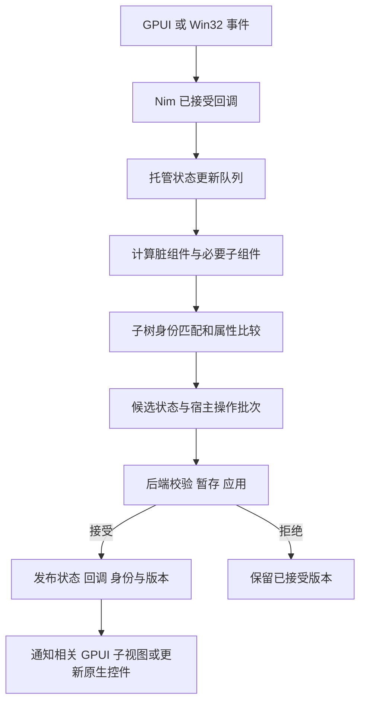

# Leaf React 式组件运行时与增量宿主设计

状态：用户于 2026-10-12 确认书面规格；尚未实施产品代码、运行新架构测试或承诺提速倍数。

源码核对基线：`96a2e035b57c8683c73957506c9a4f2a63c9141a`。
本文替代 `2026-10-11-gpui-incremental-ffi-design.md` 的方案选择；旧稿仅保留讨论记录。

## 1. 已确认的目标与设计边界

用户要求优化 Leaf 当前架构，重点解决整棵 UI 树通过 JSON 交给 Rust/GPUI 的成本，
并已选择继续细化 React 式组件、状态与协调机制。应用继续使用 Nim，不引入 JavaScript 运行时。

本规格选择：**Nim 组件运行时与协调器 + 类型化批量宿主接口 + Rust/GPUI 宿主渲染器**。
先实现同步、可验证的组件级更新；不复制 React 的 Fiber、并发调度、Suspense 和完整 Hooks 系统。

成功标准不仅是删除 JSON，还包括：

- 局部状态变化不执行无关组件，不全树 mount、inspect、重建事件索引或规范化样式。
- 首次挂载之后，跨语言只传变化的宿主操作和必要元数据。
- Rust 从持久宿主结构直接构建 GPUI 视图，不把补丁重新拼成完整 Snapshot。
- 不变的 GPUI 子视图可复用；焦点、选区、输入法组合和列表锚点保持正确。
- GPUI 与 Win32 使用同一套 Nim 组件身份和协调规则；平台布局语义仍由各自后端负责。
- 旧应用继续工作，采用新组件 API 后才获得完整的组件级计算隔离。

本次暂不处理数据库查询优化、CRUD 分页、后台任务公共 API、跨进程 UI 协议和全新控件。
这些问题仍存在，但不能与本次渲染运行时重构混为一项交付。

## 2. 为什么保留宿主节点

React 的可借鉴部分是组件计算与宿主更新分离，以及 type/key/位置驱动的状态身份。
本文借鉴这些原则，具体事务和 FFI 语义由 Leaf 定义，不声称兼容 React API。
参考 [渲染与提交](https://react.dev/learn/render-and-commit)、
[状态身份](https://react.dev/learn/preserving-and-resetting-state)和
[更新队列](https://react.dev/learn/queueing-a-series-of-state-updates)。

| 保存位置 | 保存内容 | 用途 |
| --- | --- | --- |
| Nim 组件实例 | props、托管状态、上次输出、子组件身份、待更新标记 | 决定哪些组件需要计算 |
| Nim 协调记录 | 宿主身份、已接受属性、子项顺序、回调、汇总计数 | 对比变化、校验、生成宿主操作 |
| Rust 宿主节点 | 宿主句柄、类型化属性、父子关系、渲染边界 | 持续消费补丁并供 GPUI 渲染 |
| Rust/GPUI 控件状态 | 输入编辑状态、焦点、选区、IME、滚动和测量缓存 | 保留原生交互状态 |

Rust 不保存 Nim 组件状态、业务模型、闭包或另一套组件协调树。
宿主节点本身就是渲染数据源，不额外保存旧 JSON Node 树或每次生成一份新嵌套快照。

这个方案需要 Rust 保留宿主关系，原因是下一次只收到变化部分时，它仍需知道未变化的
节点、顺序与属性。这是本次选择的增量宿主模型的成本，不是所有架构都必须多存一棵树。
Nim 持有可借用的完整描述仍是其他可行模型，但需要另一套版本和借用生命周期；本次不混用。

保留完整的已接受状态，不等于每次完整传输，也不等于每次完整重建或绘制。
首屏、整页替换和大量结构变化仍可能需要全量工作。

## 3. 整体数据流



组件 render 只计算描述；宿主提交成功后才发布候选状态和回调。
GPUI 的布局、prepaint、paint 发生在后续帧阶段，不能与 Nim render 或宿主提交耗时混算。

例如页面中有导航、报表和独立 Counter，点击 Counter 的 `+1`：

1. Nim 调用当前按钮回调，为 Counter 的 State 排队 `+1`。
2. 只执行 Counter 的 render；导航和报表不执行，已接受描述继续复用。
3. Counter 的输出参与局部对比，得到文本句柄的一个 update；不重新创建按钮和输入框。
4. Rust 收到该 update 和版本头，复制变化文本，更新宿主记录。
5. 接受后发布 Counter 的 State 与新回调，通知它的 HostView；尺寸变化仍可引起祖先布局。

这里省去的是无关计算、整树编码传输和不必要的宿主重建，不承诺屏幕只有一个区域参与布局。

## 4. 组件与状态 API

### 4.1 显式组件边界

当前普通 proc、`component` 宏和 `cached` 不等同于拥有运行时身份的组件。
新 API 必须显式实例化组件，普通 Nim 函数调用不会自动获得独立状态或更新边界。

新增 `leaf/components` 模块，提供以下概念，具体函数拼写在实现计划中固定：

- `ComponentDef[P, M]`：稳定的组件类型、mount 初始化函数和 render 函数。
- `ComponentContext`：读取本次 props/state 快照，构建描述和取得框架上下文。
- `State[T]`：由组件拥有的状态句柄；提供排队替换与函数式更新。
- `component(def, props, key)`：描述一个组件实例，不能在此直接执行它的 render。
- `componentApplication(root, ...)`：启用托管组件更新模式的应用入口。
- `invalidate(component)`、`invalidateRoot()`：显式声明外部数据已改变。

组件模型 `M` 在首次挂载时初始化一次，其中可保存多个 `State[T]`。
状态槽在 mount 阶段显式声明，第一版不提供依赖调用顺序的 `useState`，也不引入 Hooks 规则。
模型中的普通可变字段不具有自动失效能力；影响 UI 的值应使用 State 或显式 invalidate。
props 同样视为本次 render 的不可变值快照；共享可变对象必须由调用方提供稳定版本并显式失效，
不能把引用地址相同当作内容未变化的证明。

新描述使用独立的私有 `UiDescription = host | component` 表示。
现有公开 `NodeKind` 不增加 component 枚举，现有 `Node` 和控件构造函数保持兼容。
新 `componentView` DSL 支持宿主控件和组件子项，并复用现有 view 宏的语法处理；
`host(existingNode)` 可把旧 Node 子树嵌入其中。旧 Node 内没有隐式组件边界。
第一版每个组件返回一个宿主根或转交另一个组件，不增加多根 Fragment、Portal、Context。

以下仅展示拟定语义，不是当前可编译的公共 API：

```nim
# CounterModel.count 在 mount 时由框架创建，归属于这个 Counter 实例。
proc renderCounter(ctx: ComponentContext,
                   props: CounterProps, model: CounterModel): UiDescription =
  let shown = ctx.value(model.count) # 本次 render 的候选状态快照
  componentView:
    column:
      text($shown, key = "value")
      button("+1", key = "increment", onClick = proc(e: Event) =
        model.count.update(proc(previous: int): int = previous + 1))

# 父组件通过 component(Counter, props, key = "counter") 放置它。
```

### 4.2 更新语义

采用显式状态更新，不做 Vue 式属性读取依赖收集。
同一事件内的多次 State 更新按入队顺序合并，在事件回调成功返回后进行一次提交尝试。
独立点击分别处理，不能为追求批量而跨点击合并并推迟禁用按钮等行为。

- `set(value)` 排队替换值；事件中读取仍返回已接受值。
- `update(f)` 把 f 作用于队列中的前一个值；连续三次 `+1` 得到 `+3`。
- render 中通过 ctx 读取本次候选值；禁止在 render/init/updater 中排队状态更新、派发事件或执行 I/O。
- updater 必须纯净；框架不保证其被调用的次数可用于业务副作用。
- 只有显式提供安全相等比较的状态类型，才允许相等值跳过计算；其他类型保守标脏。
- 可变 ref/seq 等对象必须按值快照或采用约定不可变的版本对象，不允许原地修改
  已接受 State 所引用的内容后声称能回滚。无法保证这一点的数据应使用外部模型和 invalidate。
- 已卸载组件的 State 句柄带代数，更新返回 disposed 状态，不会命中新组件。
- 跨 runtime 使用句柄、非 UI 线程直接更新、提交中的重入更新均明确报错。

事件以外，在 UI 线程的框架任务或显式 batch 作用域中可以入队更新；退出最外层 batch 后 flush。
无 batch 的 UI 任务更新在下一个安全任务边界 flush，不在 set 内重入提交。
各后端负责安排该任务；headless 提供显式 flush 供调用方推进。
本批不为后台线程新增投递 API，也不实现优先级、时间切片和可中断 render。

### 4.3 父子计算与 memo

组件自身 State 变化时，只从该实例开始计算。祖先无需重新执行 render，但需要保留
到宿主根的路径信息，以通知布局和渲染边界。

父组件重新执行时，默认重新计算其输出中的子组件。这符合采用的 React 式语义，
不能宣传成“只要 props 没变，所有子组件天然不执行”。
昂贵子组件可显式使用 memo：提供 props 比较器或完整的版本 token；自身 State 更新仍须执行。
比较器必须涵盖影响输出和回调的所有输入，不能只比较显示文本而忽略闭包依赖。
参考 [React memo 的比较与限制](https://react.dev/reference/react/memo)。

若 memo 父组件被跳过，但后代自己有待更新，仍沿脏后代路径处理；不得整棵跳过。
若父子同时待更新，先协调父组件，复用仍存在的子实例并消费其更新一次；被父移除的
子实例丢弃队列并卸载，不执行其 render。

`cached(ctx, key, revision, ...)` 保持原语义，是描述构建缓存；它不替代组件身份、State 或 memo。

## 5. 身份与协调规则

组件身份为：**逻辑父实例/宿主父位置 + 组件类型 + key 或未命名位置**。
类型 ID 使用编译期确定的类型标识，不使用临时闭包地址或跨语言指针作为身份。

- 同父、同类型、同 key：复用状态和组件实例；同级重排不重置状态。
- key 或类型改变：旧实例卸载，新实例初始化。
- 移到其他父级：按卸载和重建处理，第一版不支持全局可移动组件身份。
- 无 key 子项按位置匹配；动态列表应提供稳定 key。
- 同父下重复显式 key 在提交前拒绝，不能以“最后一个覆盖”继续。

组件不会产生可见控件，但其身份参与后代命名空间，避免两个组件内部的 `key = "value"` 冲突。
宿主句柄由 Nim 协调器分配，单会话内不复用；公开 node ID 与便捷 key 查询保持可诊断。
旧应用继续使用原 node ID 规则；新应用的组件路径需输出稳定、可读的诊断 ID。
便捷 key 多义时继续拒绝，回调和宿主事件不依赖字符串全树搜索。

宿主身份继续遵守现有同父同种类复用规则；更换宿主祖先类型时，其原生后代重新创建。
组件状态是否保留与宿主控件是否保留分别判断，不能用一个宿主句柄替代组件身份。

修改同父子项时用 key 到旧位置的索引完成匹配。
第一版可用一次 `setChildren(parent, orderedHandles)` 表示最终顺序，Rust 直接替换该父子序列；
Win32 适配器据此更新原生顺序。无需为了得到最少 Move 操作引入二次方序列搬移。
单个大父级重排仍需 O(k) 的子项数据；不是 O(1) 更新。

## 6. Nim 如何避免全树工作

当前 `refreshImpl` 即使 cached 命中，也会 mount、inspect 并重建整树索引；
当前 Reconciler.plan 也遍历全部节点。因此新 API 不能仅包在现有 refresh 外层。

运行时保留已接受的组件和宿主记录，通过候选覆盖层更新变化部分：

1. 更新队列按组件聚合，脏后代标记沿祖先链传播。
2. 仅执行需要计算的组件；未变化输出继续引用已接受记录。
3. 对变化输出进行局部挂载、身份匹配、校验和属性规范化。
4. 事件表、node ID 表、key 多义表与资源计数按增删改更新，不复制整张表。
5. 保存候选覆盖层、删除项和回调替换，提交成功后发布；拒绝时丢弃。

索引所需容量在接受前预留，发布仅执行已准备好的交换与无失败修改；不在发布途中再分配。
候选覆盖层只服务一次尝试，接受后合入持久索引，避免每次提交累积一层查找链和历史引用。

记录必须缓存子树节点数、描述字节数、最大深度等汇总信息。
现有 MaxNodes、MaxDepth、MaxStringBytes、MaxTreeBytes、MaxListItems 的限制仍有效，
不能通过局部更新绕过全局预算；组件实例和候选内存另计并设置上限。
删除子树需要按其实际规模释放回调与状态，不能承诺恒定成本。

旧 `Snapshot` 导出与 headless 完整树查询按需从已接受记录生成，在相同 revision 下缓存。
常规宿主提交消费变化视图，不调用完整 Snapshot 导出。
用户安装了现有 `SnapshotValidator` 或依赖完整 Snapshot 的自定义 committer 时，
保留兼容适配器并允许它触发全树物化；诊断明确记录这一成本。
内置后端改用局部校验接口，避免兼容适配器成为默认热路径。

目标复杂度由脏组件输出、变更父子序列、增删子树和祖先路径决定；
只有无关静态节点增加时，局部计算与传输规模才应保持稳定。

## 7. 宿主操作与 C ABI

### 7.1 数据合同

采用同进程同步 C ABI 批量接口。权威合同为版本化 C header；Rust 使用 `#[repr(C)]`，
Nim 使用 C 兼容字段及 `.cdecl.` 回调。不直接跨边界传 Nim ref/seq/string、Rust String/Vec、
语言 enum、bool、闭包和异常。实际字段使用定宽整数、显式 tag、pointer/length 和结构大小。

批次头至少包含 session ID、base revision、next revision、操作数、字符串区长度和边界记录数。
操作覆盖：

| 操作 | 数据与含义 |
| --- | --- |
| create | 句柄、控件种类、完整类型化属性 |
| update | 已有句柄、完整的新属性；presence mask 表示恢复默认 |
| setChildren | 父句柄与最终有序子句柄列表，包括空列表 |
| remove | 删除已脱离引用的宿主句柄，子节点先释放 |
| boundary | 组件渲染边界 ID、对应宿主根与布局属性 |
| window | 标题和尺寸等窗口属性变化 |

boundary 是渲染缓存元数据，不是 Nim 组件模型。它不带 State、props 或用户闭包。
第一版属性按节点整体替换，不增加字段级 patch；文本变化不要求携带其他节点的属性。
操作校验以批次最终图为准，允许先 create 再设置关系；禁止环、多父、未知句柄、类型就地改变。
宿主删除和边界删除须与最终图一致，不能让悬空引用进入已接受版本。
利用已接受图的父关系和计数，验证变化关系及其祖先链；普通属性更新不再次遍历全图校验。

样式在 Nim 变化节点上规范化一次。共享布局/装饰/控件字段使用类型化表示，
增加明确的文本、输入、列表源版本/数量/高度模式等控件数据。
平台解释不同的样式保留后端转换，尤其不得把 GPUI 的相对尺寸和 Win32 的剩余空间 fill 混同。

### 7.2 所有权与交互

- 一个批次一次 FFI 调用；不按节点逐次调用，不通过 JSON 或文本二进制包装传输。
- 批次数组和 UTF-8 字符串区只在调用期间借用；Rust 返回前复制变化数据到自己的暂存区。
- Rust/GPUI Element 和事件闭包不能保留指向该字符串区或 Nim 对象的指针。
- 错误通过状态码和显式有界错误缓冲区返回；异常、panic 不能越过 ABI。
- prepare 预留必要容量并校验；accept 的元数据发布路径不得再分配、执行用户代码或失败。
- Rust 的事件、列表视口、状态、ready、locate 和帧测量返回类型化小结果。
  status 不附带树；列表结果不重复返回整树和 rows。
- 只更新 Nim 回调或 State 而宿主外观不变时，可以提交零操作批次以推进接受版本。
  回调保留在 Nim；Rust 事件用句柄和事件种类查询当时已接受的回调。

FFI 只消除了文本编码和解析，不是零复制：变化字符串需要 Rust 拥有一份副本。
需要统计实际字节、分配与暂存峰值，不能仅比较 ABI 调用时间。

### 7.3 版本兼容

保留 ABI 1 的符号及 `leaf_gpui_abi_version() == 1`，新协议通过独立 ABI 2 查询入口协商。
查询验证协议号、结构大小和能力。新 SDK 找不到 ABI 2 时可退回旧路径并显示诊断；
找到 ABI 2 但合同不匹配时明确失败，不能静默退回掩盖损坏的新库。
测试可强制 ABI 1/2；缺少 ABI 2 的退回路径不能计入新路径性能验收。

## 8. 候选、接受和失败

### 8.1 普通更新

事件处理顺序为：验证事件来源 → 调用已接受回调一次 → 封存本次状态队列 → 计算候选 →
校验/prepare → 后端 apply → 接受框架元数据 → Runtime 发布。
各发布步骤之间不派发业务事件、不调用户代码；事件只能观察完整的已接受版本。

新托管 State 使用下列明确语义：

- 回调抛错，或候选计算/校验/prepare/apply 在接受前失败：丢弃本次封存的 State 更新，
  保留已接受 State、组件身份、回调、宿主图和 revision；不自动重放事件。
- 若宿主部分应用后失败，先恢复已接受状态；恢复失败则冻结业务事件并报告故障。
- 新建组件的候选模型在拒绝时释放；mount/init 必须纯净，不能依赖其恰好执行一次。
- 数据库写入、文件写入、普通变量修改等回调副作用不在托管事务内，无法自动撤销。
  render 或提交失败不能被宣传成完整业务事务回滚。

保留现有 executionScope 约束：普通更新在作用域内部的提交点接受；
若作用域在 body 已成功提交之后的收尾代码抛错，不倒退已接受 revision。
诊断和新协议结果必须区分“接受前拒绝”与“已经接受但作用域收尾出错”，携带实际接受版本，
避免调用方把已提交事件再执行一次。新 State 与 Runtime 在同一提交点发布，不单独延后。

### 8.2 安装与暂存

现有 committer/preparer 安装是特殊生命周期：先暂存/apply，作用域成功退出后再确认安装。
不能把普通更新的接受时机直接套到这里。

沿用 `BackendSession` 的 prepare/apply/accepted/recover 责任边界：

- apply 完成宿主暂存/必要平台操作；安装中的候选仍不可派发事件。
- confirm 只发布已预备好的框架元数据；Rust 对应步骤仅交换宿主版本和索引，
  不运行 GPUI 更新、不调用业务、不分配或失败。
- 安装失败时，在获准进入的 executionScope 内 discard/恢复。
  作用域拒绝进入时不绕过它执行原生操作，按现有规则冻结/标记故障。
- 生命周期 owner token、foreign/stale plan 拒绝、卸载归属检查保持有效。

Rust 暂存采用受影响节点覆盖层与可撤销记录，不为每个局部更新克隆全部宿主图。
最坏情况下的大范围替换仍允许占用与变化规模相称的额外内存，并必须受预算约束。

Rust 的 HostStore 与 Desktop/GPUI 控件对象分离。调用 Nim 时不持有 HostStore 的写借用；
Nim 回调中的宿主提交只能访问这个独立存储，不能重入借用中的 Desktop 或 GPUI entity。
GPUI 的 notify、控件同步与 entity 创建在返回安全边界后执行。

## 9. GPUI 与 Win32 的落地边界

### 9.1 GPUI

Rust HostStore 使用句柄索引、类型化属性和有序子项；稳定句柄用于 GPUI element ID。
按组件边界建立持久 HostView，边界内普通叶节点不各自分配一个 Entity。
旧应用使用根边界；输入和虚拟列表继续拥有专门控件状态。

变化节点标记最近的 HostView；子项关系、边界布局或根变化通知相应父边界。
独立后代边界由自己的 entity 通知更新；布局影响可能继续向祖先传播。
窗口尺寸、主题、缩放、继承文本样式与 GPUI 全局 refresh 也必须使相关缓存失效。

当前依赖 `gpui-pre 0.3.7` 的 `Entity::cached`/`AnyView::cached` 支持视图子树缓存，
源码位于该版本 `src/view.rs`，其通知和布局约束必须在实现中验证。
初始策略仅在边界外部布局可明确传入时启用缓存；依赖内容测量而尚未证明安全的边界保守重建。
不能通过冻结缓存换取错误尺寸，也不能承诺一次文本变化只影响一个 GPU 绘制矩形。

输入框保持现有“相同模型值不覆盖编辑状态”的策略，并保留 resetToken、
composition、焦点和选区规则。输入事件提交后在安全边界同步已接受模型；
过期或已销毁的控件事件依据宿主代数和序列丢弃，不触发新的同句柄控件。
不因无关节点 revision 增长就无条件丢弃所有已排队的有效控件事件。

### 9.2 Win32

Win32 复用组件计算、局部协调、句柄、属性和提交门禁，不迁入 Rust。
宿主批次通过 Nim 平台适配器映射为已有 NativeUpdateBatch/BackendSession 操作。
第一阶段可继续使用现有原生批次布局；后续按布局失效范围缩小 SetWindowPos 等工作。

因此共享组件协调并不自动解决 Win32 当前每个非空批次全量布局的问题。
两端分别报告宿主工作量，不能以 GPUI 验收代替 Windows 实机验收。

## 10. 虚拟列表

仍只挂载可见行、overscan 和受保护的交互行，不能因采用组件模型而实例化十万行。
列表源版本、item key、可见范围、受保护 key 和高度结果进入类型化协议。
数量不变且可见行版本未变化时，status/普通帧不再次请求行描述。

视口请求按范围合并；可变高度测量可分阶段，不能把“每行一次 FFI”作为默认批量设计。
GPUI 请求行之前释放 HostStore 借用；Nim 只执行受控的行物化，不在 render 中派发业务事件。
返回后从 Rust 自有存储继续构建行视图，随后在安全位置安排必要的 entity 更新。

行内组件归属于列表实例、源代数和 item key；源替换默认更换代数并重建行组件。
同源同 key 在视口内重排可复用；旧 source/key 结果不能应用到新源的相同行号。
跨源的锚点按稳定 item key 恢复，但不等同于承诺跨源保留行内 State。

沿用当前活动行/暖缓存预算：活动与受保护行保留实时状态和事件；离屏行可暂存，
最终缓存淘汰会卸载组件并释放 State，暖描述不保留可派发事件。
需要长期保存的勾选、编辑草稿等业务状态应放在外部按 item key 索引的模型中，
不能依赖离屏组件永不卸载。实际焦点/IME 行需纳入受保护集合。

行构建、高度或源替换失败走相同提交门禁，保留原视口与原事件表。
大列表 key 构建、源替换本身仍可能 O(n)，不得算作仅可见范围成本。

## 11. 兼容与分批边界

| 应用方式 | 更新计算 | 宿主传输 | 兼容约束 |
| --- | --- | --- | --- |
| 旧 Application.render + ABI 1 | 原整树 refresh | 原 JSON | 完整保留旧行为 |
| 旧 Application.render + ABI 2 | 仍可能整树计算/协调 | 类型化增量 | 不声称已获得组件级计算收益 |
| componentApplication + ABI 2 | 脏组件计算与局部协调 | 类型化增量 | 本设计目标路径 |
| componentApplication + ABI 1 | 组件计算后物化兼容快照 | 原 JSON | 功能兼容，诊断注明成本 |

旧事件修改普通 Nim 变量后继续无条件根刷新，不要求应用先改写全部状态。
新组件模式只对 State 或显式 invalidate 作出响应；修改普通变量不能自动被检测。
新组件内的 `host(existingNode)` 子树由拥有它的组件 render 产生，内部普通函数不独立更新。
第一版不在旧 Application 根内偷偷开启局部 State 调度，避免混合更新丢失旧变量变化。

Router/PageGroup 当前保留业务对象与路由状态的行为继续使用旧模式。
适配新组件入口时必须显式选择保留隐藏页面实例还是卸载；不能把现有页面缓存改成
路由离开即销毁而称为兼容。该适配不作为桥接切换的前置条件。

分批交付依赖如下，具体文件任务和执行方法留到实现计划：

1. **类型化宿主通路**：ABI 2、HostStore、批次事务、旧应用增量宿主适配和两版兼容。
2. **托管组件运行时**：新组件/State/identity/memo API，同步队列、局部协调和索引。
3. **GPUI 缓存与列表集成**：HostView 失效、输入、虚拟列表、完整性能与平台验收。

第一批不能宣称完成本规格全部性能目标；第二批不能绕开已有提交与原生输入契约。
每批保持可运行的兼容路径，错误路径测试通过后再切换相应默认入口。

## 12. 验收标准

### 12.1 正确性

- State 的替换/函数式更新、同事件合并、独立事件、不变值优化和错误撤销符合第 4、8 节。
- key 重排保留状态，换 key/type/parent 重建；重复 key、失效句柄、重入和跨 runtime 均拒绝。
- 父子同时更新、memo 父下的脏后代、父移除有待更新子组件均得到确定结果。
- 只有回调变化、只有 State 变化但输出相同、零宿主操作版本推进都正确。
- 注入校验/prepare/apply/恢复/作用域进入和收尾错误，验证接受版本、State、事件和宿主一致性。
- 验证安装延迟确认、owner token、恢复失败冻结；不在生命周期 confirm 中操作原生控件。
- ABI 两端验证 sizeof/alignment/offsetof/stride/调用约定；校验空指针、计数溢出、UTF-8、
  未知 tag、版本不符、图环与悬空引用，且错误不越过语言边界。
- 旧应用的 view、cached、Router、headless 快照、ABI 1 与 ABI 2 切换继续可用。
- 输入同值、reset、焦点、选区、IME 与列表滚动/源替换/保护行/淘汰在实际支持的平台验证。

### 12.2 性能

必须分别记录组件 render 数、协调访问节点数、规范化节点数、索引改动数、操作数、FFI 字节、
Rust 分配、HostView render 数、布局与帧耗时、稳定内存和候选峰值。报告 median/P95 和硬件、
编译模式、提交 ID；完整帧结果与纯 Nim/桥接微基准分列。

目标场景与可验证约束：

| 场景 | 必须满足的结构性约束 |
| --- | --- |
| 独立 Counter + 100/1000/5000 个无关静态节点 | 更新只执行 Counter；协调访问和字节不随无关静态节点线性增长 |
| 同场景文本 +1 | 宿主 update 只涉及变化文本，无关控件句柄和输入状态不变 |
| 无变化 status/ready 查询 | 不 render、不导出 Snapshot、不生成 JSON、不携带 UI 树 |
| 父更新且重子组件 memo 命中 | 不执行重子组件，但其自身待更新仍能执行 |
| 5000 个同级 key 逆序 | 无二次方逐项搬移；结果顺序及状态正确，报告 O(k) 传输成本 |
| 十万行、50 行视口 | 实例和宿主节点与活动/暖缓存规模相关，不创建十万行组件 |
| 窗口缩放、主题、内容改变尺寸 | 缓存正确失效，布局和交互结果与无缓存版本一致 |
| 连续挂载/卸载/拒绝/列表滚动 | 内存趋稳，无失效闭包、悬空借用和持续积累的状态槽 |

不预先宣称所有更新 O(1) 或最佳性能。GPUI 可能因内容尺寸变化而扩大布局/绘制范围，
需要独立测量；旧模式根计算也仍可能线性增长。

历史参考：在 `a00191b` 的一次 Release/ORC 合成测量中，5004 节点计数事件加 JSON 响应
中位约 8.074 ms，status JSON 约 6.121 ms，响应 978586 字节。
它没有包含 Rust 解析、GPUI 布局或绘制，不是当前基线和新方案的比较结果。
实施验收需将基准程序与元数据保存到持久验收目录，并在同环境重新测量两条路径。

## 13. 当前结论与后续评审入口

方案选择已明确：采用 React 式组件身份、显式 State 队列和协调器；Rust 保留必要宿主数据，
通过类型化增量批次更新。它同时解决更新定位和跨语言全树传输，收益必须由上述指标验证。

本文件是架构审阅稿，不是已执行的实现计划。书面规格获确认后，再拆分文件任务、
接口合同、测试顺序、执行工作区和各批次验收；不在审阅期间修改产品运行路径。
