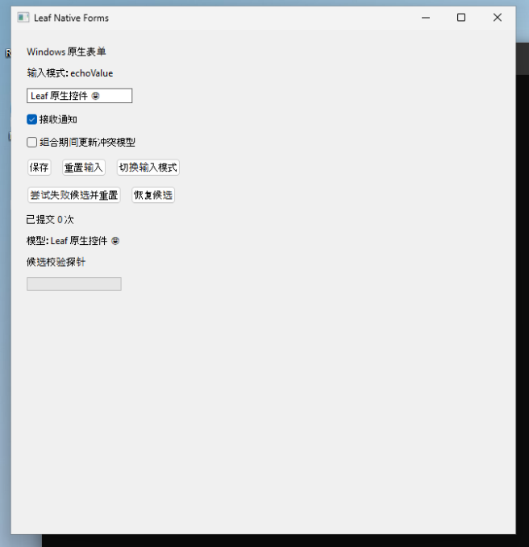

# Windows 原生表单

[示例目录](../README.md) · [源码](main.nim)

使用真实 Win32 控件演示受控输入、通知开关、保存计数、reset token 和候选失败恢复。“保存”仅增加计数，不写数据库；持久化请看[SQLite 列表示例](../native_list/README.md)。



## 运行

在 Windows x64、已配置当前源码 CLI 的终端：

```powershell
cd examples/native_forms
leaf run
```

不需要指定后端。纯逻辑检查：

```sh
leaf --check
leaf --headless --change name "测试姓名" --click save
```

## 可以试什么

| 操作 | 观察 |
| --- | --- |
| 编辑姓名并保存 | 模型文本与提交次数更新 |
| 切换输入模式 | echo 接受、reject 拒绝、trim 去掉首尾空白 |
| 重置输入 | 模型恢复初值，reset token 更新 |
| 尝试失败候选 | 非法尺寸被拒绝，不接受候选 |
| 恢复候选 | 再次提交合法状态 |

中文、emoji、选区、IME 和缩放必须在真实 Windows 窗口检查，不能由 headless 通过推断。历史测试范围见[Windows 原生验证](../../docs/native-win32-validation.md)。
