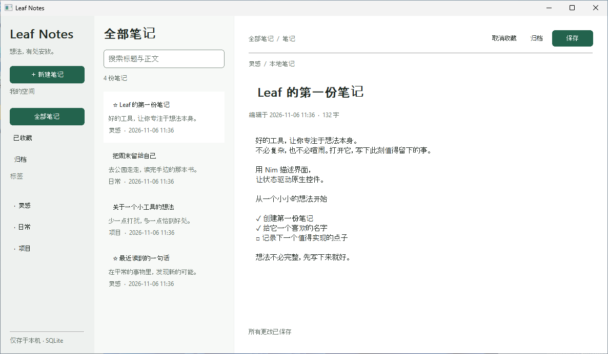

# Leaf Notes · 原生笔记 Demo

[示例目录](../README.md) · [应用组件](application.nim) · [SQLite 存储](store.nim)

一个使用 **Nim 组件状态、Win32 系统控件与 SQLite** 的三栏笔记应用。松石浅色／深色外观，导航、列表与编辑区分层；不是 WebView，也不是 HTML 设计稿。



[查看深色实拍](../../docs/screenshots/leaf-notes-dark.png) · [截图来源与验证范围](../../docs/screenshots/README.md)

## 从当前源码运行

需要 Windows x64、Nim 2.2.6+、MinGW（含 windres）。使用**当前源码构建的 CLI**；旧版 SDK 尚不包含这里新增的多行输入与主题语义。

在仓库根目录：

```powershell
nim c -d:release --out:target/nim/leaf.exe src/leaf_cli.nim
cd examples/native_notes
..\..\target\nim\leaf.exe run
```

自定义主题或数据库路径，先在示例目录构建，再直接启动 EXE：

```powershell
..\..\target\nim\leaf.exe build --output target/LeafNotes.exe
.\target\LeafNotes.exe --theme dark
.\target\LeafNotes.exe --database .\my-notes.sqlite3 --theme light
```

`--theme` 接受 `light`（默认）、`dark`、`system`，启动时选择，不支持运行中切换。应用自己的参数必须放在 Leaf 的 `--check`／`--headless` 等参数之前；不传给 CLI 的 `run` 子命令。

## 可以试什么

- **新建**：立即创建一条“未命名笔记”；首次启动提供四条示例笔记，重开不会重复初始化。
- **搜索与筛选**：搜索标题和正文；切换收藏、归档、灵感／日常／项目标签；支持空结果恢复。
- **编辑与保存**：标题与正文都是真实系统 EDIT；正文支持换行、自动折行、滚动和选区。内容仅在点击“保存”后写入 SQLite。
- **保留草稿**：切换笔记／筛选时，未保存内容留在本次会话中；关闭应用会丢弃未保存草稿，底部会提示保存。
- **整理**：收藏／归档立即持久化对应标志，不会偷偷保存正在编辑的标题或正文；归档页可移回笔记。
- **保存失败**：空标题、数据库不可写或关闭时显示错误，保留草稿，不冒充保存成功。

默认数据库位于 Windows 的 `getDataDir()/leaf-notes/notes.sqlite3`（通常是用户 AppData/Roaming）。不联网，不上传内容；“仅存于本机”不代表数据库加密。

正文是**纯文本编辑器**；示例正文中的勾选符号是文字，不是交互式待办／富文本。标签当前仅提供筛选，不提供新增／编辑标签。

## 结构与验证

- `main.nim`：参数、存储生命周期与启动主题。
- `store.nim`：参数绑定、一次性初始化、稳定 ID 与 SQLite 保存。
- `application.nim`：组件 State、草稿、虚拟列表、筛选与原生编辑。
- `tests/nim/test_native_notes*.nim`：真实数据库及真实组件事件测试。
- `tests/windows/test_win32_input.nim`、`test_win32_skin.nim`：原生多行输入与主题容器回归。

本轮已在非提权 Windows 11 / 96 DPI 窗口自测新建、键盘搜索／输入、Enter 换行、保存与重开，并查看深浅色实拍。不是完整 IME、高 DPI／混屏、高对比或辅助技术验收；独立验收未完成，详见截图来源。
